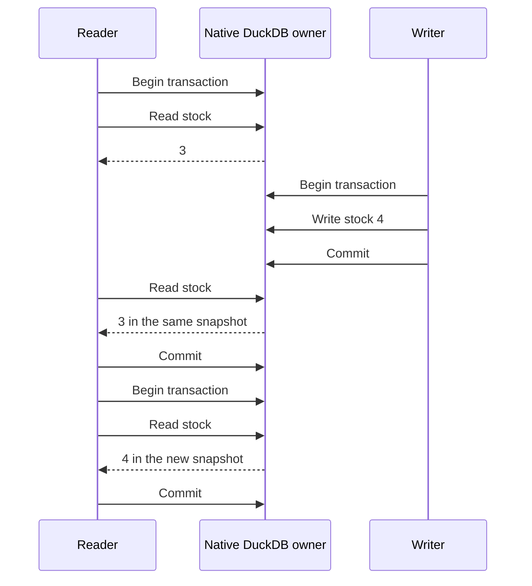

<p align="center">
  
</p>

# DuckOnWire

**Share a DuckDB database with your applications.**

DuckOnWire runs DuckDB in a C++ server so several clients can read and write the same file. Use your usual PostgreSQL driver, or connect through DuckDB's native Quack API. Each connection has its own transaction; readers can keep working while writers commit changes.

[Download rc.5](https://github.com/misaelzapata/duckonwire/releases/tag/v0.2.0-rc.5) · [Docker](#try-with-docker) · [Tutorial](#tutorial) · [Examples](#examples-and-tests) · [Español](#español) · [中文](#中文) · [MIT](LICENSE)

## Tutorial

| What you want to do | Start here |
| --- | --- |
| Try it without setting up accounts | [Docker](#try-with-docker) |
| Connect an application | [PostgreSQL connection](#connect): your normal driver, no changes to a client DuckDB installation |
| Give people access over a network | [Username, password and verified TLS](#public-access) |
| Query remote tables from DuckDB | [Native `ATTACH` and `CONNECT`](#native-connections-clear-transactions) |
| Insert data while other clients query | [Concurrent inserts](#try-concurrent-inserts) |

## Try with Docker

Clone this repository, open its folder and run:

```sh
docker compose up --build -d
docker compose exec -T duckonwire psql -X -v ON_ERROR_STOP=1 <<'SQL'
CREATE TABLE IF NOT EXISTS inventory(id INTEGER PRIMARY KEY, name VARCHAR, stock INTEGER);
INSERT INTO inventory VALUES(1, 'Coffee', 3) ON CONFLICT DO NOTHING;
UPDATE inventory SET stock = stock + 1 WHERE id = 1;
SELECT name, stock FROM inventory;
SQL
```

The first build compiles the engine for your machine and takes several minutes. Docker creates `writer` and `reader` accounts, random passwords and verified local TLS. The included `psql` reads its saved login automatically. Try the reader, then stop the server:

```sh
docker compose exec -e PGUSER=reader duckonwire psql -X -c 'SELECT name, stock FROM inventory'
docker compose stop
```

The database stays in a named volume. The published port is local only, `127.0.0.1:9496`. The [Docker workflow](.github/workflows/docker.yml) tests AMD64 and ARM64 containers, permissions, transactions, persistence and concurrent inserts. Docker support is on main; the rc.5 downloads use the setup below.

## Connect

Download the [rc.5 bundle](https://github.com/misaelzapata/duckonwire/releases/tag/v0.2.0-rc.5) for your platform, extract it and open its folder. It includes the server, native engine and examples. You can also [build from source](#build-from-source).

**Start the server.** Generate a password and use it in both terminals:

```sh
openssl rand -hex 32
export DUCKONWIRE_TOKEN='paste-the-generated-value'
./bin/duckonwire-server --init-demo
```

`--init-demo` imports the public product sample into an empty database. Use it on the first start; omit it when restarting or when you want an empty database. It refuses to import over existing tables.

**Connect your application.** In another terminal, open the same installed folder:

```sh
export PGPASSWORD='paste-the-same-generated-value'
export PGHOST=127.0.0.1 PGPORT=9496 PGUSER=duckonwire PGDATABASE=duckonwire
npm install --prefix examples/postgres/node
node examples/postgres/node/crud.mjs
```

The [Node example](examples/postgres/node/crud.mjs) inserts Coffee and Rice, updates stock, reads the rows, deletes Rice and commits. The final row is `[[1,"Coffee","19.99",4]]`, with `"passed":true`. It uses ordinary `pg`, bound values and a transaction. There are [examples in ten languages](#examples-and-tests).

The local defaults are PostgreSQL `127.0.0.1:9496`, Quack `127.0.0.1:9495` and database `data/demo.duckdb`. PostgreSQL examples accept the usual `PGHOST`, `PGPORT`, `PGUSER`, `PGDATABASE` and `PGPASSWORD` settings. They also accept `DUCKONWIRE_TOKEN` as the password.

<details>
<summary>Your own database, local passwords and SSH tunnels</summary>

Put the database inside a directory owned by the server. Stop other processes that have the file open for writing:

```sh
mkdir -p workspace
./bin/duckonwire-server --root workspace --database data/app.duckdb
```

The server creates or opens `workspace/data/app.duckdb`. Clients connect to this process rather than opening the file themselves. Stop the earlier server first, or choose different `--port` and `--pg-port` values for another database.

In default local mode, `PGUSER` is a label, not a separate account. Everyone authenticates with the shared password and has the same SQL access. Without `DUCKONWIRE_TOKEN`, the server generates a 256-bit token and saves it in its private, mode-0600 runtime descriptor.

Local PostgreSQL uses cleartext password authentication on loopback. For a remote connection through an existing SSH account:

```sh
ssh -N -L 19496:127.0.0.1:9496 your-user@your-server
```

Connect to `PGHOST=127.0.0.1 PGPORT=19496` with the server's password. SSH encrypts the tunnel. For direct network access and separate permissions, use the protected listener below.

</details>

## Public access

Users log in with a normal **username and password**. Their PostgreSQL driver handles TLS, which encrypts the connection and verifies the server, and SCRAM, which checks the password without sending it. The administrator supplies the host, port, database, account and trusted certificate.

Protected accounts have database-wide `read` or `write` access. Readers can query and use transactions; writers can also change rows and tables. The local shared-password mode does not provide these separate accounts. [Permission tests](tests/results/public-access.json).

<details>
<summary>Set up accounts and verified TLS</summary>

Place the certificate, private key and rules file inside the server root. The certificate must match the hostname clients use. Keep the key and rules file mode `0600` or `0400`; clients need the issuing CA certificate.

Generate separate passwords and their SCRAM verifiers. The rules file stores verifiers, not the original passwords:

```sh
export PGPASSWORD="$(openssl rand -hex 32)"
verifier="$(printf '%s\n' "$PGPASSWORD" | ./bin/duckonwire-password)"
export PGREADER_USER=reader PGREADER_PASSWORD="$(openssl rand -hex 32)"
reader_verifier="$(printf '%s\n' "$PGREADER_PASSWORD" | ./bin/duckonwire-password)"
(umask 077; printf 'database\tduckonwire\nuser\tapp\twrite\t%s\nuser\treader\tread\t%s\n' "$verifier" "$reader_verifier" > access.tsv)
```

Stop the local server before starting the protected listener. Import external data first:

```sh
./bin/duckonwire-server --access-file access.tsv \
  --tls-cert server.crt --tls-key server.key --pg-host 0.0.0.0
```

The file uses tab-separated records: `database`, database name; then `user`, username, `read` or `write`, verifier. Unknown users and database names are rejected. The password tool accepts 32–1024 printable ASCII characters. Restart to apply rule changes.

On the client, set `PGPASSWORD` to the application account's password:

```sh
export PGHOST=db.example.com PGPORT=9496 PGUSER=app PGDATABASE=duckonwire
export PGSSLMODE=verify-full PGSSLROOTCERT=ca.pem
node examples/postgres/node/crud.mjs
```

For the reader, use `PGUSER=reader` and its password. Keep passwords out of URLs and command arguments. Do not disable certificate verification. [TLS reference](https://www.postgresql.org/docs/current/libpq-ssl.html) · [Password authentication](https://www.postgresql.org/docs/current/auth-password.html).

</details>

<details>
<summary>Permissions and query limits</summary>

The PostgreSQL endpoint runs up to 8 queries at once and requests cancellation after 30 seconds by default. Extra work returns `53300`; cancelled queries return `57014`. After an explicit transaction fails, roll it back before retrying. Cancellation is cooperative, so blocked I/O can take longer.

Protected mode also limits DuckDB buffers and spill storage to 1 GiB each and closes idle/incomplete connections after 300 seconds. These are not hard limits on total process memory or I/O. Adjust query limits with `--max-queries` and `--query-timeout-ms`.

Protected SQL cannot read external files or networks, install extensions or change server configuration. Import data locally before enabling it. Permissions cover the whole database, not individual tables or rows; this is not a complete PostgreSQL role system or a hardened multi-tenant service. SCRAM-SHA-256-PLUS is not implemented.

Quack remains a separate, trusted loopback connection using the local token. PostgreSQL accounts, permissions and query limits do not apply to it.

</details>

## Native connections, clear transactions

Use Quack when your application needs DuckDB's native API. It requires the paired engine and Quack protocol **7**. HTTPFS and Quack are built in, so there are no extension paths or `LOAD` commands to configure.

### ATTACH a remote catalog

On a native DuckDB connection, attach the server and read its tables by name:

```sql
ATTACH 'quack:127.0.0.1:9495' AS remote (TOKEN 'your-server-token');
SELECT id, name, brand FROM remote.main.products LIMIT 5;
```

`remote` is the catalog alias; `main` is the schema. You can join these tables with local data in the same client. The sample `products` table is available after starting the server with `--init-demo`.

### CONNECT for parameters, writes and transactions

Switch that connection to the server before using bound parameters, doing general CRUD or managing transactions:

```sql
CONNECT remote;
```

Subsequent statements, bound parameters and transaction commands run on the server. You can also connect directly with `CONNECT 'quack:127.0.0.1:9495' (TOKEN 'your-server-token')`.

When finished, use `DISCONNECT` to resume local queries and `DETACH remote` to remove the catalog alias.

Use `ATTACH` for the read/join examples above and `CONNECT` for queries with bound parameters, writes and transactions. Plain `ATTACH` has limitations with parameterized queries, updates/deletes and cached schema metadata; it does not provide full CRUD compatibility.

The [C++ ATTACH example](examples/attach.cpp) reads a remote table, joins it with local data, then uses `CONNECT remote` for parameterized changes, commit and rollback. It creates and removes its own sample table.

`attach-client` is included when you build and install current main. After compiling, you can also run `./build/bin/attach-client`. The rc.5 engine supports the SQL above, but its downloads predate this new executable; use their `./bin/cpp-crud-client` for direct `CONNECT`. With a current installation, run:

```sh
export DUCKONWIRE_ENDPOINT=quack:127.0.0.1:9495
export DUCKONWIRE_TOKEN='your-server-token'
./bin/attach-client
./bin/transaction-flow
```

**Transactions work the same way through either endpoint.** Statements commit automatically unless you send `BEGIN`. `COMMIT` keeps changes; `ROLLBACK` discards them. Closing a connection rolls back pending work. Give each concurrent worker its own connection.

A reader keeps the same view until its transaction ends, even after another writer commits. Start a new transaction to see those changes. Two writers changing the same row can conflict: roll back and re-read before retrying. If the connection breaks during `COMMIT`, check the outcome before repeating a write.

<details>
<summary>See how a reader's snapshot changes</summary>



The [transaction example](examples/transaction_flow.cpp) checks snapshots, rollback and conflicting writes. DuckDB keeps its transaction snapshot even when a PostgreSQL client requests `READ COMMITTED`; `SERIALIZABLE` is rejected. The server owns the file once and gives every client an independent DuckDB connection. This does not bypass the file lock: other processes must use the server instead of opening that file for writing.

</details>

## Examples and tests

PostgreSQL clients use their usual drivers, with no client DuckDB engine:

[Node.js](examples/postgres/node/crud.mjs) · [Python](examples/postgres/python/crud.py) · [Java](examples/postgres/java/Crud.java) · [C](examples/postgres/c/crud.c) · [C++](examples/postgres/cpp/crud.cpp) · [Swift](examples/postgres/swift/Crud.swift) · [Lua](examples/postgres/lua/crud.lua) · [Go](examples/postgres/go/main.go) · [Rust](examples/postgres/rust/src/main.rs) · [C#](examples/postgres/csharp/Program.cs).

<details>
<summary>Run the other language examples</summary>

Use the same standard `PG*` settings as Node:

```sh
pip install -r examples/postgres/python/requirements.txt
python examples/postgres/python/crud.py
(cd examples/postgres/go && go run .)
cargo run --manifest-path examples/postgres/rust/Cargo.toml
dotnet run --project examples/postgres/csharp/Crud.csproj
```

Java uses PostgreSQL JDBC 42.7.7 on its classpath. C/C++, Swift and Lua use libpq; Lua runs through LuaJIT FFI. These examples use PostgreSQL drivers, not the native Quack executables.

Native Quack examples: [C](examples/crud_c.c) · [C++](examples/crud_cpp.cpp) · [Python](examples/python/crud.py) · [Node.js](examples/node/crud.mjs) · [Go](examples/go/crud/main.go) · [Rust](examples/rust/src/crud.rs) · [Java](examples/java/NormalCrud.java) · [Swift](examples/swift/Crud.swift) · [C#](examples/csharp/crud/Program.cs) · [Lua](examples/lua/client.lua). These need compatible bindings; see the version details below before using an existing DuckDB installation.

</details>

### Try concurrent inserts

The [Node ingestion example](examples/postgres/node/ingest.mjs) sends bound values in batches of 1,000. Four writers insert while four readers run joins, grouped sums and latest-price windows. It checks the results and removes its own fixture tables:

```sh
PG_INGEST_ROWS=100000 node examples/postgres/node/ingest.mjs
node examples/postgres/node/ingest.mjs
```

The second command uses two million rows. Run one copy per test database at a time because the table names are fixed. For protected access, set `PGREADER_USER` and `PGREADER_PASSWORD` to use a separate reader account; otherwise the readers use the writer's login.

The JSON includes throughput, read latency, confirmed commits and each reader's progress during writes. `bulk.mjs` is a different test: it generates rows inside DuckDB with `INSERT SELECT range`, rather than sending row values from the client.

## Measurements

In a local Apple M1 Pro test, Node sent **2,000,000 rows** over TLS/SCRAM with four writers and four readers: **313,781 rows/s**, with reads averaging **5.24 ms**.

Rows contained three integers, sent in 2,000 batches of 1,000. The 6.37-second measurement includes client row creation, transport and confirmed commits; it excludes login, table setup and final checks. Counts, checksums and complex queries passed in the same session. This is one small numeric workload over loopback, not a production or WAN estimate. [Results and exact test conditions](tests/results/postgres-compatibility.json).

<details>
<summary>Database-generated rows and earlier native Quack tests</summary>

These PostgreSQL tests generated two million rows *inside DuckDB*: 80 prepared batches of 25,000, four writers and four read-only readers.

| Driver, macOS loopback | Generated rows/s | Mean read latency |
| --- | ---: | ---: |
| Node.js `pg` 8.16.3 | 4,134,046 | 4.78 ms |
| Python `psycopg` 3.3.6 | 4,150,084 | 6.05 ms |

This measures database-side generation and writes, not client-data transport. Timing excludes setup, login and final checks. Both runs checked counts, checksums and reader progress; the Python run also reopened the server to check persistence. See the [full PostgreSQL results](tests/results/postgres-compatibility.json).

The rc.4 native Quack tests also used two million generated rows, 80 batches, four writers and four readers. They checked counts and checksums after reopening:

| Platform, loopback | Generated rows/s | Mean read latency |
| --- | ---: | ---: |
| macOS 26 ARM64 | 1,500,866 | 29.10 ms |
| Ubuntu 24.04 x86-64-v3 | 854,892 | 49.10 ms |

One client process used eight worker threads; Quack added the server process. Reads mixed joins, counts, aggregation and windows. See the rc.4 [manifest](https://github.com/misaelzapata/duckonwire/releases/download/v0.2.0-rc.4/release.json), [macOS results](https://github.com/misaelzapata/duckonwire/releases/download/v0.2.0-rc.4/benchmark-macos.json) and [Linux results](https://github.com/misaelzapata/duckonwire/releases/download/v0.2.0-rc.4/benchmark-linux.json). These are earlier measurements, not timings of each new release.

</details>

## Compatibility

SQL runs in DuckDB. PostgreSQL drivers can connect without installing or replacing DuckDB on the client; native Quack clients need the paired engine and protocol 7. PostgreSQL protocol support does not make every PostgreSQL SQL feature, catalog or ORM work here.

<details>
<summary>Tested drivers, versions and limits</summary>

| PostgreSQL client | Driver tested |
| --- | --- |
| Node.js | `pg` 8.16.3 |
| Python | `psycopg` 3.3.6 |
| Java | PostgreSQL JDBC 42.7.7 |
| C / C++ / Swift / Lua | libpq 18.3; Swift 6.4 / LuaJIT 2.1 |
| Go | `pgx` 5.7.6 |
| Rust | `tokio-postgres` 0.7.15 |
| C# | Npgsql 8.0.8 |

[Driver results](tests/results/postgres-compatibility.json) cover ten languages on macOS ARM64, complex queries, transactions and TLS/SCRAM. Linux CI checks C, Python and Node. The Flask example pins its own dependencies separately.

Prepared values are bound, never interpolated into SQL. Unsupported type OIDs return errors. DuckDB lists, structs and maps return as text; PostgreSQL array codecs, network `COPY` and complete role/catalog emulation are not implemented.

Native C/C++ packages use DuckDB `v2.1.0-dev0`, fork `848126236a`, with Quack protocol 7. A tested stock Node DuckDB `v1.5.6` engine rejected our extension because its native ABI differs. Other engine/protocol combinations are not promised to work.

Earlier rc.3 macOS tests covered Python `2.1.0.dev0+duckonwire.638b09261a`, rebuilt Node `@duckdb/node-api` `1.5.6-r.1`, patched JDBC source `5b624bb72a88`, Go `duckdb-go/v2` `v2.10506.0`, Rust `duckdb` `1.10506.0`, C# `DuckDB.NET.Data` `1.5.6`, Swift 6.4 and LuaJIT `2.1.1788856981`. Those used patched core `638b09261a`; they are historical binding tests, not new tests of every rc.5 binding. [Version and result index](tests/results/index.json).

</details>

## S3 and Cloudflare R2

Built-in HTTPFS can read S3 and R2 from trusted local connections. For example, this reads the byte count of a public S3 object:

```sql
SELECT size FROM read_blob('s3://noaa-ghcn-pds/ghcnd-countries.txt');
```

For Parquet, use `read_parquet('s3://your-bucket/your-file.parquet')`. Private objects need your own credentials in a connection-local secret. R2 uses `TYPE r2` and an `r2://bucket/object` URI. [S3 setup](https://duckdb.org/docs/current/core_extensions/httpfs/s3api) · [R2 setup](https://duckdb.org/docs/current/guides/network_cloud_storage/cloudflare_r2_import).

[Cloud tests](tests/results/object-storage.json) checked real reads locally, through Quack and through PostgreSQL against byte counts and SHA-256; no objects were modified. Protected listeners block external reads and secret creation, so import data locally first. Explicit credentials work with built-in HTTPFS; AWS IAM `credential_chain` also needs the AWS extension.

## Public demo

The sample contains **46,462 manufacturer-brand products** from Argentina and Spain, with reproducible **synthetic prices**. It has no stores, private-label brands or private identifiers. The [CSV](examples/demo/products.csv) and [schema](examples/demo/schema.sql) are included for `--init-demo`. Benchmarks use separate generated tables. Own code is MIT; see [third-party notices](THIRD_PARTY_NOTICES.txt).

## Flask playground

The [web example](examples/postgres/flask/app.py) uses ordinary Flask and `psycopg`. Give it a real protected **read-only account**; connection settings stay on the backend. It offers catalog queries, joins and window functions, caps results at 200 rows and times out long queries. Each request closes its connection; the database reader rule prevents writes.

<details>
<summary>Run the web example</summary>

```sh
python3 -m venv .venv-flask
.venv-flask/bin/pip install -r examples/postgres/flask/requirements.txt
export PGHOST=db.example.com PGPORT=9496 PGDATABASE=duckonwire
export PGUSER=reader PGPASSWORD='your-reader-account-password' PGSSLMODE=verify-full
cd examples/postgres/flask
../../../.venv-flask/bin/gunicorn --bind 127.0.0.1:8000 --workers 2 --threads 2 --timeout 40 app:app
```

Open `http://127.0.0.1:8000`. Public certificates use system trust roots. For a private CA, set `PGSSLROOTCERT` to its certificate file.

</details>

## Server options

<details>
<summary>Paths, ports, access rules and query limits</summary>

| Option | Purpose | Default or example |
| --- | --- | --- |
| `--root DIRECTORY` | Keep database, runtime state and configuration in one workspace. Directory must exist. | Current directory; `workspace` |
| `--database PATH` | Open or create the database inside the root. | `data/demo.duckdb` |
| `--state PATH` | Store the private descriptor, including the local token. Must differ from the database path. | `.runtime/native.json` |
| `--init-demo` | Import the public sample into an empty database. Omit on restart. | Off |
| `--port NUMBER` | Quack loopback port. | `9495`; 1–65535 |
| `--pg-port NUMBER` | PostgreSQL port; `0` selects a free port recorded in the descriptor. | `9496`; 0–65535 |
| `--pg-host ADDRESS` | PostgreSQL listen address. Non-loopback requires protected access. | `127.0.0.1` |
| `--access-file PATH` | Tab-separated database and account rules; requires TLS. | Off; `access.tsv` |
| `--tls-cert PATH` | Server certificate matching the client's hostname. | Required with access rules; `server.crt` |
| `--tls-key PATH` | Private key inside the root, mode `0600` or `0400`. | Required with access rules; `server.key` |
| `--max-queries NUMBER` | Simultaneous PostgreSQL queries; excess work returns `53300`. | `8`; 1–256 |
| `--query-timeout-ms NUMBER` | Request cooperative cancellation after this many milliseconds. | `30000`; 1–3600000 |
| `--help` | Print options and exit. | `./bin/duckonwire-server --help` |

Relative paths resolve inside `--root`. Ctrl+C or SIGTERM closes sessions and removes the runtime descriptor. Do not delete the descriptor or database while the server is running.

</details>

## For agents and contributors

[AGENTS.md](AGENTS.md) explains ownership, connection choices and verification. The [documentation workflow](.github/workflows/documentation.yml) checks the guides and runs login, transactions, ordinary drivers, TLS/SCRAM and concurrent inserts. Exact versions, platforms and results are in the [result index](tests/results/index.json).

## Build from source

<details>
<summary>Build, test and install</summary>

You need CMake 3.24+, Ninja, C++17, Git and OpenSSL/libcurl development files:

```sh
git clone https://github.com/misaelzapata/duckonwire.git
cd duckonwire
cmake -S . -B build -G Ninja -DCMAKE_BUILD_TYPE=Release
cmake --build build --parallel 3
ctest --test-dir build --output-on-failure
cmake --install build --prefix dist
cd dist
```

Run the examples from the installed folder. The server and tests live here; engine changes are in the [DuckDB](https://github.com/misaelzapata/duckdb/tree/duckonwire/native) and [Quack](https://github.com/misaelzapata/duckdb-quack/tree/duckonwire/native) forks. [Pins](cmake/Pins.cmake) fix the dependency versions. [Package.cmake](cmake/Package.cmake) contains packaging instructions.

The rc.5 native bundles target macOS 26 ARM64 or Ubuntu 24.04 x86-64-v3 with glibc 2.39, libcurl 4 and OpenSSL 3. Windows is not tested. This is an experimental development build.

</details>

## Español

DuckOnWire comparte una base DuckDB mediante un servidor C++. Puedes conectar tu aplicación con su driver PostgreSQL habitual, sin cambiar una instalación de DuckDB en el cliente.

Para probarlo, clona el repositorio y ejecuta `docker compose up --build -d`. El [ejemplo con psql](#try-with-docker) crea una tabla, inserta, actualiza y consulta. Docker prepara las cuentas y TLS; `docker compose stop` conserva la base en su volumen. También puedes [descargar rc.5](https://github.com/misaelzapata/duckonwire/releases/tag/v0.2.0-rc.5) y seguir la [conexión local](#connect).

En modo local se comparte una contraseña; el nombre de usuario no crea permisos separados. Para acceso por red, configura usuarios reales de lectura o escritura y un certificado. El login sigue siendo usuario y contraseña: el driver se encarga de TLS y SCRAM.

Si necesitas la API nativa, usa el motor compatible con Quack y protocolo 7. `ATTACH` expone las tablas como `remote.main.products` y permite unirlas con datos locales. Usa `CONNECT remote` para consultas con parámetros, escritura y transacciones; `ATTACH` solo no ofrece CRUD completo. El [ejemplo C++](examples/attach.cpp) muestra ambos pasos.

Cada conexión tiene su transacción. `COMMIT` confirma, `ROLLBACK` descarta y cerrar revierte lo pendiente. Un lector conserva su vista hasta terminar la transacción; dos escritores sobre la misma fila pueden entrar en conflicto. Hay [diez ejemplos](#examples-and-tests), una [página Flask de solo lectura](#flask-playground) y una [guía para agentes](AGENTS.md). Los detalles de seguridad, versiones y compilación quedan en los apartados desplegables.

## 中文

DuckOnWire 用原生 C++ 服务器共享 DuckDB，应用可使用普通 PostgreSQL 驱动，无需更换客户端 DuckDB。Docker 会自动配置本地账号与 TLS，并将数据库保存在持久卷中。

Quack 原生连接需要匹配的引擎和协议 7：`ATTACH` 用于读取远程表并与本地数据连接，参数查询、写入和事务请使用 `CONNECT remote`。网络访问支持用户名、密码、验证 TLS 和 SCRAM；项目提供十种语言示例，MIT 许可。
