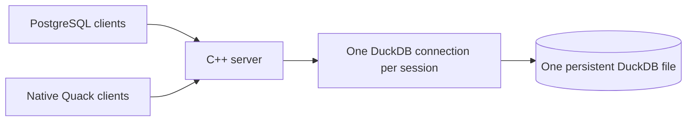
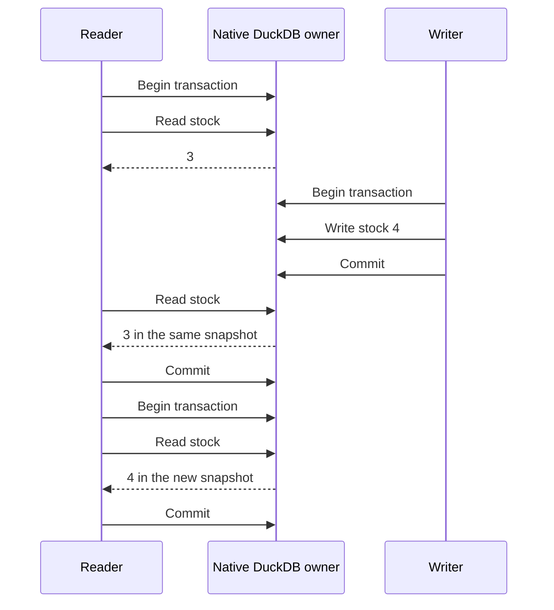

<p align="center">
  
</p>

# DuckOnWire

**DuckDB on the server. Your usual database driver on the client.**

Share one persistent DuckDB database through a C++ server. Connect with a normal PostgreSQL driver, or use native DuckDB through Quack `CONNECT`. Both endpoints share the same engine and independent transactions. HTTPFS and Quack are built in.

- **Keep your client DuckDB version:** PostgreSQL clients do not import or replace DuckDB.
- **Read while writers work:** independent sessions and snapshot isolation.
- **Keep your data:** commits persist; disconnecting rolls back pending writes.

[Build current source](#connect) · [Quack-only rc.4 bundles](https://github.com/misaelzapata/duckonwire/releases/tag/v0.2.0-rc.4) · [MIT](LICENSE)

## Connect

The PostgreSQL endpoint is new in source; the existing rc.4 downloads contain the previous Quack server. Build with CMake 3.24+, Ninja, C++17, Git and OpenSSL/libcurl development files:

```sh
git clone https://github.com/misaelzapata/duckonwire.git
cd duckonwire
cmake -S . -B build -G Ninja -DCMAKE_BUILD_TYPE=Release
cmake --build build --parallel 3
openssl rand -hex 32
export DUCKONWIRE_TOKEN='paste-the-generated-value'
build/bin/duckonwire-server --root . --init-demo
```

In another terminal:

```sh
export PGPASSWORD='paste-the-same-generated-value'
npm install --prefix examples/postgres/node
node examples/postgres/node/crud.mjs
```

The example inserts Cafe and Arroz, updates stock, selects rows, deletes Arroz and commits. Final row: `[[1,"Cafe","19.99",4]]`. Each language uses its usual driver directly, binds values and keeps other clients' rows.

Defaults: PostgreSQL `127.0.0.1:9496`, Quack `127.0.0.1:9495`, database `data/demo.duckdb`. PostgreSQL examples accept standard `PGHOST`, `PGPORT`, `PGUSER`, `PGDATABASE`, `PGPASSWORD`; `DUCKONWIRE_TOKEN` is also accepted. Restart without `--init-demo`. Endpoints bind to loopback; use an SSH tunnel for a remote connection. Protected public access is described below; complete PostgreSQL roles/catalog emulation is not implemented.

<details>
<summary>Username, password and remote access</summary>

The default local listener treats `PGUSER` as a driver label, not a separate account: it authenticates one shared password and provides no per-user permissions. Omitting it lets the driver choose its default. Anyone with the password has the server’s DuckDB SQL access.

Without `DUCKONWIRE_TOKEN`, the server generates 32 random bytes from the operating system (64 hexadecimal characters, 256 bits) and writes the value only to its private, mode-0600 runtime descriptor. A configured value replaces that generated password; use a random value such as the command above. Short CI passwords are test fixtures. The default local endpoint uses PostgreSQL cleartext password authentication on loopback; use an encrypted SSH tunnel or the protected TLS/SCRAM listener below for remote access.

</details>

## Public access

The protected listener uses **TLS + SCRAM-SHA-256** and a small rules file for one published database. `read` allows queries and transactions; `write` also allows table/schema changes and CRUD. Rules apply to the whole database, not individual tables. Use one owner process per database. [Permission and query-limit results](tests/results/public-access.json).

<details>
<summary>Configure a protected listener</summary>

Supply a certificate for your hostname and its private key inside the server root. The key and rules file must have mode `0600` or `0400`. Generate a password and its SCRAM verifier:

```sh
export PGPASSWORD="$(openssl rand -hex 32)"
verifier="$(printf '%s\n' "$PGPASSWORD" | build/bin/duckonwire-password)"
(umask 077; printf 'database\tduckonwire\nuser\tapp\twrite\t%s\n' "$verifier" > access.tsv)
build/bin/duckonwire-server --root . --access-file access.tsv \
  --tls-cert server.crt --tls-key server.key --pg-host 0.0.0.0
```

The file uses real tab separators. First record: `database`, database name. Remaining records: `user`, username, `read` or `write`, SCRAM verifier. Add a reader with its own verifier; unknown users and database names are rejected. Passwords generated by the tool require 32–1024 printable ASCII characters. Restart to apply rule changes.

Clients use their normal driver settings and verify the certificate:

```sh
export PGHOST=db.example.com PGUSER=app PGDATABASE=duckonwire
export PGSSLMODE=verify-full PGSSLROOTCERT=ca.pem
node examples/postgres/node/crud.mjs
```

PostgreSQL executes at most **8 queries at once** by default and requests native cancellation after **30 seconds**. Cancellation is cooperative; this is not a hard operating-system deadline for blocked I/O. Excess work receives `53300`; native cancellation returns `57014`. Roll back an explicit failed transaction before retrying, with a delay. Configure these limits with `--max-queries` and `--query-timeout-ms`. Protected mode also limits DuckDB buffers and spill storage to 1 GiB each; this is not a hard limit on total process memory. Authenticated protected connections close after a 300-second idle/frame deadline. These query controls apply to the PostgreSQL endpoint; trusted loopback Quack retains native engine behavior.

Use the generated `PGPASSWORD` in the client environment. No passwords in connection URLs or command arguments. Protected mode blocks external-file/network SQL, extension installation and configuration changes. Initialize or import data locally before enabling it; HTTPFS S3/R2 reads remain available in trusted local mode. Quack stays on loopback with a separate local token. This is basic database access control, not PostgreSQL roles, row-level security or a hardened multi-tenant service. SCRAM-SHA-256-PLUS is not implemented; clients must verify TLS certificates.

</details>

## Compatibility

| Connection | Client requirement | Status |
| --- | --- | --- |
| PostgreSQL protocol 3.0 | Ordinary PostgreSQL driver; no client DuckDB needed | Current-source tests recorded below |
| Native Quack `CONNECT` | DuckOnWire DuckDB `v2.1.0-dev0` + Quack protocol **7** | Fresh C/C++ rc.4 qualification on macOS and Linux |
| Stock DuckDB Node engine `v1.5.6` + our extension | Different engine/extension ABI | Tested combination rejected the extension |
| Other DuckDB/Quack versions | Matching remote protocol and native extension ABI | Not qualified by this project |

PostgreSQL compatibility means the connection protocol and supported data types. Queries still use **DuckDB SQL**. It does not make DuckDB a complete PostgreSQL server or establish compatibility with every ORM. Prepared parameters never become interpolated SQL; unsupported type OIDs return an explicit error. DuckDB lists, structs and maps are returned as text; PostgreSQL array codecs and network `COPY` are not implemented.

<details>
<summary>PostgreSQL drivers and tested versions</summary>

| Language | Ordinary driver |
| --- | --- |
| Node.js | `pg` 8.16.3 |
| Python | `psycopg` 3.3.6 |
| Java | PostgreSQL JDBC 42.7.7 |
| C / C++ / Swift / Lua | libpq 18.3; Swift 6.4 / LuaJIT 2.1 |
| Go | `pgx` 5.7.6 |
| Rust | `tokio-postgres` 0.7.15 |
| C# | Npgsql 8.0.8 |

[Driver results](tests/results/postgres-compatibility.json) record two CRUD runs per language, complex queries, transactions and 44 TLS/SCRAM/permission checks. These versions do not need a client DuckDB engine. Fresh qualification covers macOS ARM64; Linux CI runs the native tests and C, Python and Node PostgreSQL clients.

</details>

<details>
<summary>Native Quack language bindings and exact tested versions</summary>

| Language | Binding/version | Evidence |
| --- | --- | --- |
| C / C++ | DuckDB `v2.1.0-dev0`, fork `848126236a` | Fresh rc.4 macOS/Linux native acceptance |
| Python | duckdb `2.1.0.dev0+duckonwire.638b09261a`, CPython 3.12 | Historical rc.3 macOS |
| Node.js | `@duckdb/node-api` `1.5.6-r.1`, rebuilt addon | Historical rc.3 macOS |
| Java | DuckDB JDBC source `5b624bb72a88`, patched JNI | Historical rc.3 macOS |
| Go | `duckdb-go/v2` `v2.10506.0` | Historical rc.3 macOS |
| Rust | `duckdb` `1.10506.0`, dynamically linked | Historical rc.3 macOS |
| C# | `DuckDB.NET.Data` `1.5.6` | Historical rc.3 macOS |
| Swift | Swift 6.4 with native C API | Historical rc.3 macOS |
| Lua | LuaJIT `2.1.1788856981` with native C API | Historical rc.3 macOS |

The rc.3 suite used the patched core `638b09261a` and protocol 7. Those binding results are historical, not fresh rc.4 driver qualification. Quack clients need a compatible native engine; choose a PostgreSQL driver to leave an existing DuckDB installation untouched. [Version/result index](tests/results/index.json).

</details>

## How multiple connections work

**One process owns the DuckDB file; every client gets an independent native connection to that same engine.** PostgreSQL drivers send protocol messages to our C++ endpoint; Quack `CONNECT` uses the native remote extension. Both execute DuckDB SQL against the same database.



The owner creates `duckdb::DuckDB` once. Each PostgreSQL session creates a real `duckdb::Connection(database)`; Quack also maintains independent server sessions. Typed values are bound to prepared statements. Connection-local transactions and cursors stay in their own session, and disconnecting rolls back pending changes.

Readers can query while writers insert or update. A transaction keeps its snapshot until it ends; committed changes become visible to a new transaction. Writers updating the same row can conflict and must roll back and retry. This does not bypass DuckDB’s file lock: applications that need simultaneous access must connect to the owner instead of opening its file directly for writes. Use a separate client connection for each concurrent worker.

## Native connections, clear transactions

A client creates an actual DuckDB connection:

```cpp
duckdb::DuckDB database(nullptr);
duckdb::Connection connection(database);
auto result = connection.Query(
    "CONNECT 'quack:127.0.0.1:9495' (TOKEN 'choose-your-token')");
if (result->HasError()) result->ThrowError();
```

The runnable examples escape connection settings and bind data values. Each PostgreSQL or Quack connection has its own transaction. Statements autocommit unless you use `BEGIN`; `COMMIT` confirms writes and `ROLLBACK` discards pending work.



Use a separate connection per concurrent worker. DuckDB uses transaction snapshots: a requested PostgreSQL `READ COMMITTED` transaction retains its snapshot until it ends. `SERIALIZABLE` is rejected. Two writers changing the same row can conflict: roll back and re-read before retrying. If the connection breaks during `COMMIT`, reconcile the outcome before repeating a non-idempotent write. The [native transaction flow](examples/transaction_flow.cpp) checks snapshots, rollback and conflict recovery.

## Measured with readers and writers

Current-source PostgreSQL tests inserted **2,000,000 rows per driver** with **TLS + SCRAM**, four writers and four readers using a separate read-only account. Every reader completed queries during writes; grouped joins and latest-price CTE/window results matched exact expectations.

| Ordinary PostgreSQL driver, macOS ARM64 loopback | Insert rows/s | Mean mixed read latency |
| --- | ---: | ---: |
| Node.js `pg` 8.16.3 | 4,134,046 | 4.78 ms |
| Python `psycopg` 3.3.6 | 4,150,084 | 6.05 ms |

These fixtures generate rows with **80 prepared batches of 25,000**, with 80 confirmed commits; they do not send two million individual inserts. Timing excludes setup, authentication and final checks. Counts and checksums passed in both runs; the Python run additionally verified persistence after stopping and reopening the server. Measurements use two engine threads on an Apple M1 Pro and show this workload on loopback, not production or WAN performance. [Full results and scopes](tests/results/postgres-compatibility.json).

Fresh **rc.4 binaries** inserted **2,000,000 rows per mode**, with **4 writers + 4 readers**, and verified counts/checksums after reopening. Every reader completed queries during writes.

| Native Quack over loopback | Insert rows/s | Mean mixed read latency |
| --- | ---: | ---: |
| macOS 26 ARM64 | 1,500,866 | 29.10 ms |
| Ubuntu 24.04 x86-64-v3 | 854,892 | 49.10 ms |

Writes use 80 typed prepared `INSERT SELECT range` batches of 25,000 rows. One native client process has eight worker threads with independent connections; Quack adds the owner process. Reads mix point joins, counts, aggregation and latest-price windows. These are hardware-dependent observations: batch-generated rows, not two million individual network inserts, and loopback rather than WAN latency.

See the immutable [release manifest](https://github.com/misaelzapata/duckonwire/releases/download/v0.2.0-rc.4/release.json), [macOS results](https://github.com/misaelzapata/duckonwire/releases/download/v0.2.0-rc.4/benchmark-macos.json) and [Linux results](https://github.com/misaelzapata/duckonwire/releases/download/v0.2.0-rc.4/benchmark-linux.json). Both platforms passed **21 native checks, 14 transaction-flow checks and 17 bootstrap checks**. Older rc.3 results remain historical evidence.

## Examples and tests

PostgreSQL: [Node.js](examples/postgres/node/crud.mjs) · [Python](examples/postgres/python/crud.py) · [Java](examples/postgres/java/Crud.java) · [C](examples/postgres/c/crud.c) · [C++](examples/postgres/cpp/crud.cpp) · [Swift](examples/postgres/swift/Crud.swift) · [Lua](examples/postgres/lua/crud.lua) · [Go](examples/postgres/go/main.go) · [Rust](examples/postgres/rust/src/main.rs) · [C#](examples/postgres/csharp/Program.cs).

The [stock Node workload](examples/postgres/node/bulk.mjs) inserts **2,000,000 rows** in 80 prepared batches, with four writers and four readers running CTE, join, grouping and latest-price window queries. It checks exact counts and checksums and removes only its own fixture tables:

```sh
node examples/postgres/node/bulk.mjs
```

<details>
<summary>Run the other PostgreSQL examples</summary>

Use the same `PGPASSWORD` and standard `PG*` settings as Node. Install each language's usual driver:

```sh
pip install -r examples/postgres/python/requirements.txt
python examples/postgres/python/crud.py
(cd examples/postgres/go && go run .)
cargo run --manifest-path examples/postgres/rust/Cargo.toml
dotnet run --project examples/postgres/csharp/Crud.csproj
```

Java uses PostgreSQL JDBC 42.7.7: compile `examples/postgres/java/Crud.java` and add that driver JAR to the normal Java classpath. C/C++ and Swift use libpq headers/library; Lua uses LuaJIT FFI and libpq. These PostgreSQL examples do not use the bundled Quack C/C++ client executables.

</details>

Native Quack: [C](examples/crud_c.c) · [C++](examples/crud_cpp.cpp) · [Python](examples/python/crud.py) · [Node.js](examples/node/crud.mjs) · [Go](examples/go/crud/main.go) · [Rust](examples/rust/src/crud.rs) · [Java](examples/java/NormalCrud.java) · [Swift](examples/swift/Crud.swift) · [C#](examples/csharp/crud/Program.cs) · [Lua](examples/lua/client.lua).

```sh
ctest --test-dir build --output-on-failure
```

Windows is not qualified. Native bundles target macOS 26 ARM64 or Ubuntu 24.04 x86-64-v3, glibc 2.39, libcurl 4 and OpenSSL 3. This is an experimental development build.

<details>
<summary>Source pins, upstream updates and packaging</summary>

Our server, tests and examples live here. [DuckDB](https://github.com/misaelzapata/duckdb/tree/duckonwire/native) and [Quack](https://github.com/misaelzapata/duckdb-quack/tree/duckonwire/native) changes live in separate forks. [Pins.cmake](cmake/Pins.cmake) fixes DuckDB `848126236a4a8879f232bed7ab5f702683a55300`, Quack `a6e7cb9243ee3d7ec0e5371b720be3292a32061f` and official HTTPFS `96a2f2e88e5dd075facbc5a65dc3afd67aa2bb44`.

CMake keeps clean checkouts in `upstream/` and build copies in `build/sources/`; it does not replay core/Quack patches. Canonical diffs remain in `patches/`. To update upstream, fetch it, choose a fixed commit, merge or rebase on a new integration branch, then rebuild and retest before changing pins. Never follow a moving HEAD.

[Package.cmake](cmake/Package.cmake) packages a clean committed checkout and completed native build, verifies installed binaries, and emits an archive, manifest and checksums. GitHub supplies source archives at the release tag. [Historical results index](tests/results/index.json) preserves prior build provenance.

</details>

## S3 and Cloudflare R2

HTTPFS is built into the server. S3 and R2 reads were checked locally, through Quack and through a stock PostgreSQL driver, matching byte counts and SHA-256 against real object-storage reads. No cloud objects were modified. [Recorded cloud results](tests/results/object-storage.json). Protected public listeners disable these external reads by default.

```sql
SELECT size FROM read_blob('s3://noaa-ghcn-pds/ghcnd-countries.txt');
```

R2 uses a `TYPE r2` secret and an `r2://bucket/object` URI; use your own account and credentials. [R2 setup](https://duckdb.org/docs/current/guides/network_cloud_storage/cloudflare_r2_import) · [S3 setup](https://duckdb.org/docs/current/core_extensions/httpfs/s3api). Explicit credentials are supported by built-in HTTPFS; AWS IAM `credential_chain` additionally needs the AWS extension.

## Public demo

**46,462 real manufacturer-brand products** from Argentina and Spain, with reproducible **synthetic prices**. No stores, retailer/private-label brands or private identifiers. Included [CSV](examples/demo/products.csv) and [schema](examples/demo/schema.sql) support `--init-demo`; the benchmark uses a separate generated fixture. Own code is MIT; see [third-party notices](THIRD_PARTY_NOTICES.txt).

## Español

DuckOnWire comparte una base DuckDB mediante un servidor C++. El endpoint PostgreSQL permite usar drivers normales sin cambiar DuckDB en los clientes; Quack conserva la API nativa con un motor compatible con protocolo 7. Ambos usan sesiones independientes: `COMMIT` confirma, `ROLLBACK` descarta y cerrar una conexión revierte cambios pendientes. Cada cliente obtiene una conexión DuckDB nativa dentro del mismo proceso dueño del archivo; así hay lectores y escritores simultáneos sin abrir el archivo desde varios procesos. La tabla distingue versiones probadas y evidencia histórica. El endpoint PostgreSQL se compila desde el código actual; los paquetes rc.4 anteriores contienen sólo Quack. El acceso público básico usa TLS y SCRAM, con usuarios de lectura o escritura por base y límites de consultas; SQL y almacenamiento siguen siendo DuckDB. Proyecto experimental, MIT; demo público de Argentina y España con precios ficticios.

## 中文

DuckOnWire 通过原生 C++ 服务器共享 DuckDB。普通 PostgreSQL 驱动无需更换客户端 DuckDB；Quack 原生连接需要匹配的引擎与协议 7。两种连接共享数据库，各自保持独立事务。兼容表区分实测版本与历史结果；新版 PostgreSQL 接口需从当前源码编译。公开接口使用 TLS 与 SCRAM，并提供数据库读写权限和查询限制。SQL 与存储仍使用 DuckDB。实验项目，MIT 许可。
