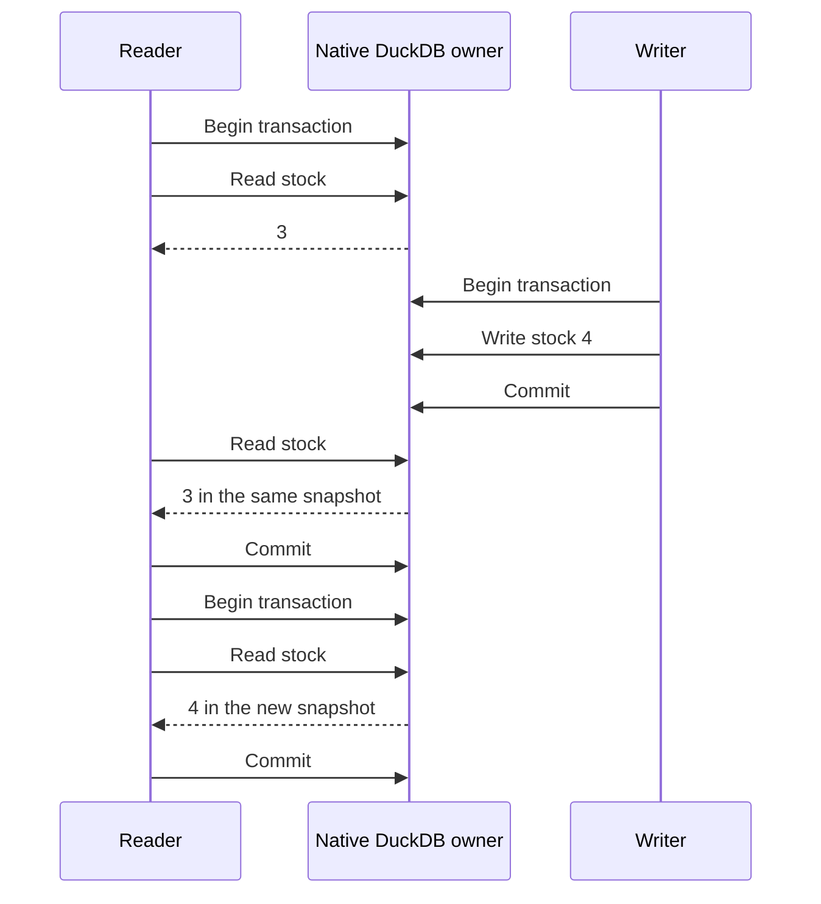

<p align="center">
  
</p>

# DuckOnWire (DoW)

**DuckDB, connected.**

[](https://github.com/misaelzapata/duckonwire/actions/workflows/verify.yml) [](.github/workflows/verify.yml) [](https://github.com/misaelzapata/duckonwire/actions/workflows/docker.yml)

DoW turns your DuckDB database into a shared data service. Connect apps in your favorite language, read and write through the same connection, and let readers keep working while new data arrives. Your data stays in DuckDB.

[Download](https://github.com/misaelzapata/duckonwire/releases) · [Try Docker](#try-with-docker) · [Connect from Neon](#query-from-neon) · [Examples](#examples-and-tests) · [Español](#español) · [中文](#中文) · [MIT](LICENSE)

## Tutorial

Start with Docker to try a few queries. For an application, use the [PostgreSQL connection](#connect); it does not install or replace DuckDB on your client. [Native Quack](#native-connections-clear-transactions) is available when you want DuckDB's own API and can use the compatible engine.

**One connection can read and write.** Use `SELECT`, `INSERT`, `UPDATE` and `DELETE` on the same connection, with `BEGIN`, `COMMIT` and `ROLLBACK` when you need a transaction. A `write` account allows both reading and writing; a `read` account allows only reading. The [Neon example](#query-from-neon) separately provides read-only foreign tables.

## Try with Docker

Clone this repository, open its folder and run:

```sh
docker compose up --build -d
docker compose exec -T duckonwire psql -X -v ON_ERROR_STOP=1 <<'SQL'
CREATE TABLE IF NOT EXISTS inventory(id INTEGER PRIMARY KEY, name VARCHAR, stock INTEGER);
INSERT INTO inventory VALUES(1, 'Coffee', 3) ON CONFLICT DO NOTHING;
BEGIN;
SELECT name, stock FROM inventory WHERE id = 1;
UPDATE inventory SET stock = stock + 1 WHERE id = 1;
SELECT name, stock FROM inventory WHERE id = 1;
COMMIT;
SQL
```

On the first run, stock changes from 3 to 4. The first build takes several minutes. Docker prepares separate writer and reader accounts, random passwords and verified local TLS. The included `psql` reads its saved login automatically:

```sh
docker compose exec -e PGUSER=reader duckonwire psql -X -c 'SELECT name, stock FROM inventory'
docker compose stop
```

Stopping preserves the database in its named volume. Port `9496` is published only on `127.0.0.1`. The [Docker workflow](.github/workflows/docker.yml) tests AMD64 and ARM64, transactions, permissions, persistence and concurrent inserts.

## Connect

DoW is experimental. Clients use PostgreSQL drivers, and queries run in DuckDB SQL.

[Download a native package](https://github.com/misaelzapata/duckonwire/releases), extract it and open its folder. Packages include the server and its native engine. The repository contains the newest examples; [building from source](#build-from-source) is optional.

**Start the server.** Generate a password and use it in both terminals:

```sh
openssl rand -hex 32
export DUCKONWIRE_TOKEN='paste-the-generated-value'
./bin/duckonwire-server --init-demo
```

`--init-demo` imports the public product sample into an empty database. Use it once; omit it when restarting or when you want an empty database. It refuses to import over existing tables.

**Run a client.** In another terminal, from the same installed folder:

```sh
export PGPASSWORD='paste-the-same-generated-value'
export PGHOST=127.0.0.1 PGPORT=9496 PGUSER=duckonwire PGDATABASE=duckonwire
npm install --prefix examples/postgres/node
node examples/postgres/node/crud.mjs
```

The example inserts Coffee and Rice, updates stock, reads the rows, deletes Rice and commits. It prints `"passed":true` and `[[1,"Coffee","19.99",4]]`. Open the [Node source](examples/postgres/node/crud.mjs) to see the connection and bound parameters, or pick another language below.

Defaults are PostgreSQL `127.0.0.1:9496`, Quack `127.0.0.1:9495` and database `data/demo.duckdb`. In this local mode, everyone uses the shared password; the username is a label, not a separate account.

<details>
<summary>Your own database and remote connections</summary>

Keep the database inside the server's workspace and stop any other process that has it open for writing:

```sh
mkdir -p workspace
./bin/duckonwire-server --root workspace --database data/app.duckdb
```

The C++ server opens or creates `workspace/data/app.duckdb` and gives each client its own connection and transaction. Other applications connect to the server instead of opening the file directly. Stop the previous server first, or use different `--port` and `--pg-port` values for another database.

Without `DUCKONWIRE_TOKEN`, the server generates a token in its private runtime descriptor. Local PostgreSQL uses cleartext password authentication on loopback. For remote access, use the protected setup below or an encrypted SSH tunnel:

```sh
ssh -N -L 19496:127.0.0.1:9496 your-user@your-server
```

Connect to `PGHOST=127.0.0.1 PGPORT=19496` with the server's password. Standard `PGHOST`, `PGPORT`, `PGUSER`, `PGDATABASE` and `PGPASSWORD` settings work with the examples; `DUCKONWIRE_TOKEN` is also accepted as a password.

</details>

## Query from Neon

Connect Neon to DoW once, then query `duckonwire.products` and `duckonwire.prices` from your normal Neon connection. You can join them with Neon tables; the data stays in DuckDB.

The [Neon setup guide](docs/neon.md) walks through the hostname, certificate, reader login, setup and cleanup. This integration uses read-only foreign tables. For reading and writing, connect your app directly to DoW with a `write` account: the same connection handles both.

```sql
SELECT id, name, brand FROM duckonwire.products ORDER BY id LIMIT 5;
```

Use DoW 0.3 or newer for Neon support. [Integration results](tests/results/neon-integration.json) include a real Neon connection, complete product reads and queries while another connection writes.

## Public access

Users log in with their usual PostgreSQL **username and password**. TLS encrypts the connection and verifies the server; SCRAM checks the password without sending it. Give each account database-wide `read` or `write` access. This is separate from local shared-password mode.

<details>
<summary>Set up accounts and verified TLS</summary>

Put the server certificate, private key and rules file inside the server root. The certificate must match the hostname clients use. Keep the key and rules file mode `0600` or `0400`; clients need a trusted issuing CA.

Generate passwords and SCRAM verifiers. The rules file contains verifiers, not the original passwords:

```sh
export PGPASSWORD="$(openssl rand -hex 32)"
verifier="$(printf '%s\n' "$PGPASSWORD" | ./bin/duckonwire-password)"
export PGREADER_USER=reader PGREADER_PASSWORD="$(openssl rand -hex 32)"
reader_verifier="$(printf '%s\n' "$PGREADER_PASSWORD" | ./bin/duckonwire-password)"
(umask 077; printf 'database\tduckonwire\nuser\tapp\twrite\t%s\nuser\treader\tread\t%s\n' "$verifier" "$reader_verifier" > access.tsv)
./bin/duckonwire-server --access-file access.tsv \
  --tls-cert server.crt --tls-key server.key --pg-host 0.0.0.0
```

Stop the local server before starting this one. Import external data before enabling protected mode. The tab-separated file starts with `database`, database name; each following record is `user`, username, `read` or `write`, verifier. Restart to apply changes.

On a client, use that account's password and verify the server certificate:

```sh
export PGHOST=db.example.com PGPORT=9496 PGUSER=app PGDATABASE=duckonwire
export PGSSLMODE=verify-full PGSSLROOTCERT=ca.pem
node examples/postgres/node/crud.mjs
```

Readers can query and use transactions. Writers can also change rows and tables. Unknown accounts and database names are rejected. Keep passwords out of URLs, command arguments and logs; do not disable TLS verification. [Permission tests](tests/results/public-access.json).

</details>

<details>
<summary>Permissions and query limits</summary>

The PostgreSQL endpoint runs up to 8 queries at once and requests cancellation after 30 seconds by default. Extra work returns `53300`; cancellation returns `57014`. After an explicit transaction fails, roll it back before retrying. Cancellation is cooperative, so blocked I/O can take longer.

Protected mode limits DuckDB buffers and spill storage to 1 GiB each and closes idle/incomplete connections after 300 seconds. These are not hard limits on total process memory or I/O. Use `--max-queries` and `--query-timeout-ms` to adjust query limits.

Protected SQL cannot read external files or networks, install extensions or change server configuration. Import data locally first. Permissions cover the database, not individual tables or rows; full PostgreSQL roles and SCRAM channel binding are not implemented.

Quack remains a separate trusted loopback connection with the local token. PostgreSQL accounts, permissions and query limits do not apply to it.

</details>

## Native connections, clear transactions

Use Quack with DuckOnWire's compatible native engine. HTTPFS and Quack are built in; no extension paths or `LOAD` commands are needed. An unrelated stock DuckDB engine is not automatically compatible. Exact bindings and protocol versions are recorded in [AGENTS.md](AGENTS.md) and the [result index](tests/results/index.json).

### ATTACH a remote catalog

On a native connection, read remote tables by name and join them with local data:

```sql
ATTACH 'quack:127.0.0.1:9495' AS remote (TOKEN 'your-server-token');
SELECT id, name, brand FROM remote.main.products LIMIT 5;
```

`remote` is the catalog alias and `main` is the schema. The sample table exists after `--init-demo`.

### CONNECT for parameters, writes and transactions

Switch the connection to the server:

```sql
CONNECT remote;
```

Subsequent SQL and bound values run on the server. Use this for parameterized queries, CRUD and transactions: plain `ATTACH` has limits with parameters, updates/deletes and cached schema metadata. Use `DISCONNECT` to resume local queries, then `DETACH remote` to remove the alias.

The [ATTACH example](examples/attach.cpp) reads and joins remote data, then uses `CONNECT remote` for changes, commit and rollback. It removes its own sample table. After building current source:

```sh
export DUCKONWIRE_ENDPOINT=quack:127.0.0.1:9495
export DUCKONWIRE_TOKEN='your-server-token'
./build/bin/attach-client
```

Installed packages also have `./bin/cpp-crud-client` for direct `CONNECT`. The new ATTACH executable is available in current source builds; check a package's included files before using it.

### Transactions

Use one connection per concurrent worker. Statements commit automatically unless you send `BEGIN`; `COMMIT` keeps changes and `ROLLBACK` discards them. Closing a connection rolls back pending work.

Readers keep their view until the transaction ends. Two writers changing the same row can conflict: roll back and re-read before retrying. If a connection breaks during `COMMIT`, check the outcome before repeating the write.

<details>
<summary>See a reader's snapshot before and after a commit</summary>



The [transaction example](examples/transaction_flow.cpp) checks snapshots, rollback and conflicts. A requested PostgreSQL `READ COMMITTED` transaction retains DuckDB's snapshot; `SERIALIZABLE` is rejected. The server owns the database file once and gives clients separate native connections.

</details>

## Examples and tests

CI verifies **106 checks** across seven native test suites, plus **20 PostgreSQL integration checks**, ordinary-driver examples and concurrent reads during million-row inserts. The [release workflow](.github/workflows/release.yml) builds a fresh package and publishes it only after tests, the tutorial and Docker pass. [See the results](tests/results/index.json).

Ordinary PostgreSQL drivers, using standard `PG*` settings:

[Node.js](examples/postgres/node/crud.mjs) · [Python](examples/postgres/python/crud.py) · [Java](examples/postgres/java/Crud.java) · [C](examples/postgres/c/crud.c) · [C++](examples/postgres/cpp/crud.cpp) · [Swift](examples/postgres/swift/Crud.swift) · [Lua](examples/postgres/lua/crud.lua) · [Go](examples/postgres/go/main.go) · [Rust](examples/postgres/rust/src/main.rs) · [C#](examples/postgres/csharp/Program.cs).

<details>
<summary>Run other language examples</summary>

```sh
pip install -r examples/postgres/python/requirements.txt
python examples/postgres/python/crud.py
(cd examples/postgres/go && go run .)
cargo run --manifest-path examples/postgres/rust/Cargo.toml
dotnet run --project examples/postgres/csharp/Crud.csproj
```

Java uses PostgreSQL JDBC on its classpath. C/C++, Swift and Lua use libpq; Lua runs through LuaJIT. Tested driver versions and platform coverage are in the [PostgreSQL results](tests/results/postgres-compatibility.json).

Native Quack examples use compatible bindings: [C](examples/crud_c.c) · [C++](examples/crud_cpp.cpp) · [Python](examples/python/crud.py) · [Node.js](examples/node/crud.mjs) · [Go](examples/go/crud/main.go) · [Rust](examples/rust/src/crud.rs) · [Java](examples/java/NormalCrud.java) · [Swift](examples/swift/Crud.swift) · [C#](examples/csharp/crud/Program.cs) · [Lua](examples/lua/client.lua). Some binding tests are historical; check the [result index](tests/results/index.json) before treating them as current package support.

</details>

### Try concurrent inserts

The [Node ingestion example](examples/postgres/node/ingest.mjs) sends bound values in batches of 1,000. Four writers insert while four readers run joins, grouped sums and latest-price windows. It checks the results and removes its fixture tables:

```sh
PG_INGEST_ROWS=100000 node examples/postgres/node/ingest.mjs
node examples/postgres/node/ingest.mjs
```

The second command sends two million rows. Use a test database and run one copy at a time. For protected access, set `PGREADER_USER` and `PGREADER_PASSWORD`; otherwise readers use the writer's login. The JSON reports throughput, read latency, commits and each reader's progress.

One local Apple M1 Pro run sent **two million client rows at 313,781 rows/s**, with reads averaging **5.24 ms**. Timing included row creation, transport and 2,000 confirmed commits; login, setup and final checks were excluded. Counts, checksums and complex queries passed in-session. This small numeric loopback workload is not a WAN estimate. [Full results](tests/results/postgres-compatibility.json).

`bulk.mjs` and the native benchmark generate rows inside DuckDB with `INSERT SELECT range`. Those results measure database-side generation and writes, not client-data transport. See their distinct conditions in the [result index](tests/results/index.json).

## Public demo

The sample contains **46,462 manufacturer-brand products** from Argentina and Spain, with **synthetic prices**. It has no stores, private-label brands or private identifiers. [CSV](examples/demo/products.csv) and [schema](examples/demo/schema.sql) are included for `--init-demo`. Benchmarks use separate tables. Own code is MIT; see [third-party notices](THIRD_PARTY_NOTICES.txt).

## Flask playground

Try the [live playground](https://dow.ofertasya.app/), or run the included [Flask example](examples/postgres/flask). Browse tables, inspect columns, preview rows and run your own SQL. Example queries cover products, brands, countries and price comparisons. Its source is included under MIT.

Run it with a protected **read-only account**. Connection settings stay on the backend; results are capped at 200 rows and long queries are cancelled. Connections are reused for quicker queries, with a fresh transaction for every request. The reader rule prevents writes.

<details>
<summary>Run the web example</summary>

```sh
python3 -m venv .venv-flask
.venv-flask/bin/pip install -r examples/postgres/flask/requirements.txt
export PGHOST=db.example.com PGPORT=9496 PGDATABASE=duckonwire
export PGUSER=reader PGPASSWORD='your-reader-account-password' PGSSLMODE=verify-full
cd examples/postgres/flask
../../../.venv-flask/bin/gunicorn --bind 127.0.0.1:8000 --workers 2 --threads 2 --timeout 40 app:app
```

Open `http://127.0.0.1:8000`. Public certificates use system trust roots; set `PGSSLROOTCERT` for a private CA.

</details>

## S3 and Cloudflare R2

Built-in HTTPFS reads object storage from trusted local connections:

```sql
SELECT size FROM read_blob('s3://noaa-ghcn-pds/ghcnd-countries.txt');
```

For Parquet, use `read_parquet('s3://your-bucket/your-file.parquet')`. Private objects need your credentials in a connection-local secret. [S3 setup](https://duckdb.org/docs/current/core_extensions/httpfs/s3api) · [R2 setup](https://duckdb.org/docs/current/guides/network_cloud_storage/cloudflare_r2_import) · [Real read tests](tests/results/object-storage.json).

Protected accounts cannot read external objects or create cloud secrets; import data locally first. Built-in HTTPFS supports explicit credentials; AWS IAM credential chains additionally need the AWS extension.

## Server options


<details>
<summary>Paths, ports, access rules and query limits</summary>

| Option | Purpose | Default or example |
| --- | --- | --- |
| `--root DIRECTORY` | Keep database, runtime state and configuration in one workspace. Directory must exist. | Current directory; `workspace` |
| `--database PATH` | Open or create the database inside the root. | `data/demo.duckdb` |
| `--state PATH` | Store the private descriptor, including the local token. Must differ from the database path. | `.runtime/native.json` |
| `--init-demo` | Import the public sample into an empty database. Omit on restart. | Off |
| `--port NUMBER` | Quack loopback port. | `9495`; 1–65535 |
| `--pg-port NUMBER` | PostgreSQL port; `0` selects a free port recorded in the descriptor. | `9496`; 0–65535 |
| `--pg-host ADDRESS` | PostgreSQL listen address. Non-loopback requires protected access. | `127.0.0.1` |
| `--access-file PATH` | Tab-separated database and account rules; requires TLS. | Off; `access.tsv` |
| `--tls-cert PATH` | Server certificate matching the client's hostname. | Required with access rules; `server.crt` |
| `--tls-key PATH` | Private key inside the root, mode `0600` or `0400`. | Required with access rules; `server.key` |
| `--max-queries NUMBER` | Simultaneous PostgreSQL queries; excess work returns `53300`. | `8`; 1–256 |
| `--query-timeout-ms NUMBER` | Request cooperative cancellation after this many milliseconds. | `30000`; 1–3600000 |
| `--help` | Print options and exit. | `./bin/duckonwire-server --help` |

Relative paths resolve inside `--root`. Ctrl+C or SIGTERM closes sessions and removes the runtime descriptor. Do not delete the descriptor or database while the server is running.

</details>

## For agents and contributors

[AGENTS.md](AGENTS.md) covers ownership, pinned dependencies and checks. The [documentation workflow](.github/workflows/documentation.yml) runs login, transactions, stock drivers and concurrent queries. The [result index](tests/results/index.json) records exact versions and platforms. PostgreSQL protocol support does not imply complete PostgreSQL SQL, catalogs, roles, arrays, network `COPY` or ORM compatibility; queries still run in DuckDB.

## Build from source

<details>
<summary>Build, test and install</summary>

You need CMake, Ninja, a C++ compiler, Git and OpenSSL/libcurl development files:

```sh
git clone https://github.com/misaelzapata/duckonwire.git
cd duckonwire
cmake -S . -B build -G Ninja -DCMAKE_BUILD_TYPE=Release
cmake --build build --parallel 3
ctest --test-dir build --output-on-failure
cmake --install build --prefix dist
```

Run installed examples from `dist`. Exact prerequisites and platform limits are in [AGENTS.md](AGENTS.md); source pins are in [cmake/Pins.cmake](cmake/Pins.cmake). Engine changes live in the [DuckDB](https://github.com/misaelzapata/duckdb/tree/duckonwire/native) and [Quack](https://github.com/misaelzapata/duckdb-quack/tree/duckonwire/native) forks. [Package.cmake](cmake/Package.cmake) contains packaging instructions. This is an experimental project; Windows is not tested.

</details>

## Español

DoW conecta tu base DuckDB con tus aplicaciones. Usa el driver habitual de tu lenguaje y sigue leyendo mientras llegan nuevos datos. **Una misma conexión permite leer y escribir:** puedes hacer `SELECT`, `INSERT`, `UPDATE` y `DELETE`, además de `BEGIN`, `COMMIT` y `ROLLBACK`. Una cuenta `write` permite ambas cosas; una cuenta `read`, solo consultar. La base permanece en DuckDB. Para probarlo, ejecuta `docker compose up --build -d`; las cuentas y TLS se preparan automáticamente, y `docker compose stop` conserva la base.

Desde [Neon](#query-from-neon), `postgres_fdw` presenta las tablas remotas para consultarlas y unirlas con datos locales. El ejemplo usa una cuenta de solo lectura y TLS verificado; los datos permanecen en DuckDB.

En local se comparte una contraseña. Por red puedes configurar usuarios reales con permisos de lectura o escritura. Quack requiere el motor nativo compatible: `ATTACH` permite leer y unir tablas, y `CONNECT remote` es la ruta para consultas parametrizadas, CRUD y transacciones.

`COMMIT` confirma cambios, `ROLLBACK` los descarta y cerrar revierte lo pendiente. Cada trabajador usa su conexión. Hay [diez ejemplos](#examples-and-tests), una [página Flask](#flask-playground) y una [guía para agentes](AGENTS.md); los detalles de configuración y compilación están en apartados desplegables.

## 中文

DuckOnWire（DoW）让应用连接 DuckDB，在新数据写入时继续读取。普通 PostgreSQL 驱动无需更换客户端 DuckDB；Docker 自动配置本地账号与 TLS，Neon 可通过只读 `postgres_fdw` 和验证 TLS 查询远程表。

原生 Quack 需要匹配的引擎：`ATTACH` 用于读取和连接远程表，参数查询、写入及事务使用 `CONNECT remote`。项目提供十种语言示例，MIT 许可。
