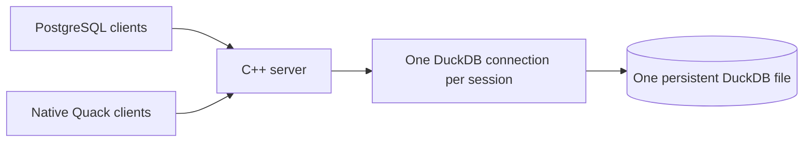
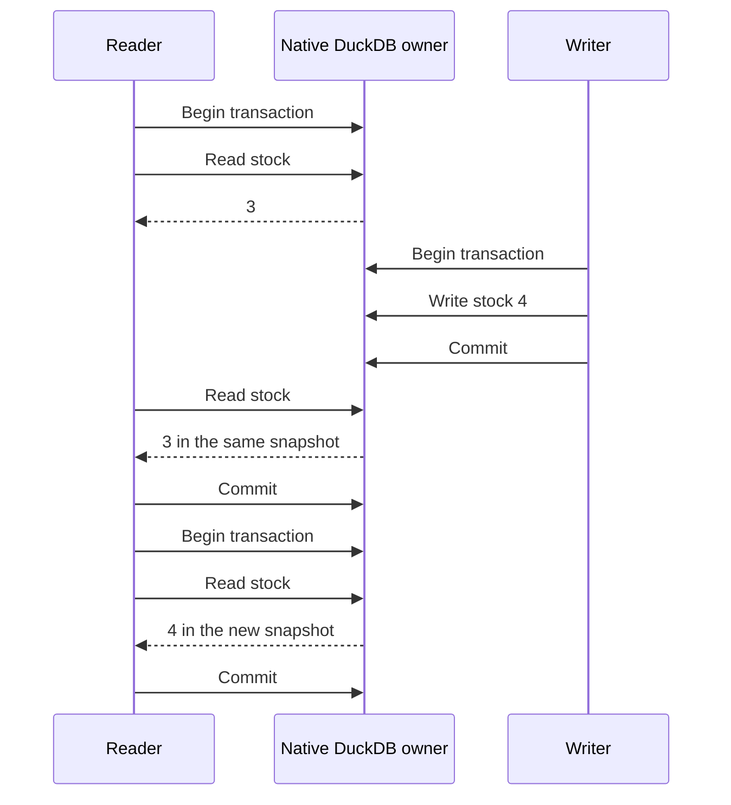

<p align="center">
  
</p>

# DuckOnWire

**DuckDB on the server. Your usual database driver on the client.**

Share one persistent DuckDB database through a C++ server. Connect with a normal PostgreSQL driver, or use native DuckDB through Quack `CONNECT`. Both endpoints share the same engine and independent transactions. HTTPFS and Quack are built in.

- **Keep your client DuckDB version:** PostgreSQL clients do not import or replace DuckDB.
- **Read while writers work:** independent sessions and snapshot isolation.
- **Keep your data:** commits persist; disconnecting rolls back pending writes.

[Download rc.5](https://github.com/misaelzapata/duckonwire/releases/tag/v0.2.0-rc.5) · [Docker](#try-with-docker) · [Tutorial](#tutorial) · [Examples](#examples-and-tests) · [MIT](LICENSE)

## Tutorial

Choose the connection that fits your application:

| I want to… | Choose | What I configure |
| --- | --- | --- |
| Try it with Docker | [Docker demo](#try-with-docker) | Docker Compose; accounts and local TLS are created automatically |
| Try it on my computer | [Local PostgreSQL connection](#connect) | A shared password; your normal PostgreSQL driver |
| Give people access over a network | [Protected PostgreSQL connection](#public-access) | A username, password and a trusted server certificate |
| Use DuckDB's native connection API | [Quack connection](#native-connections-clear-transactions) | The paired DuckDB engine, endpoint and local token |
| Insert data while other clients query | [Concurrent workload](#try-concurrent-inserts) | One connection per worker |
| Read objects from S3 or R2 | [Object storage](#s3-and-cloudflare-r2) | Trusted local access and, for private objects, your own cloud credentials |

Start with the local example. The protected option uses the same ordinary **username-and-password login**; TLS and SCRAM are handled by the driver. You do not build a separate login screen or call a project-specific client API.

## Try with Docker

Clone this repository and run these commands from its folder. The first build compiles the native engine for your machine and takes several minutes:

```sh
docker compose up --build -d
docker compose exec -T duckonwire psql -X -v ON_ERROR_STOP=1 <<'SQL'
CREATE TABLE IF NOT EXISTS inventory(id INTEGER PRIMARY KEY, name VARCHAR, stock INTEGER);
INSERT INTO inventory VALUES(1, 'Coffee', 3) ON CONFLICT DO NOTHING;
UPDATE inventory SET stock = stock + 1 WHERE id = 1;
SELECT name, stock FROM inventory;
SQL
```

Docker creates separate `writer` and `reader` accounts with private random passwords and verified local TLS. The included `psql` reads its saved login automatically. Try the reader:

```sh
docker compose exec -e PGUSER=reader duckonwire psql -X -c 'SELECT name, stock FROM inventory'
docker compose stop
```

The named volume preserves your database across stops and restarts. The published port is local only (`127.0.0.1:9496`); use the [public-access setup](#public-access) for your own network deployment. The [Docker workflow](.github/workflows/docker.yml) checks native AMD64 and ARM64 containers, transactions, permissions, persistence and concurrent client inserts. Docker files are available on the main branch; the frozen rc.5 bundles use the setup below.

## Connect

**1. Start the server.** Download the [rc.5 bundle](https://github.com/misaelzapata/duckonwire/releases/tag/v0.2.0-rc.5) for your platform, extract it and open its folder. It includes the server, paired native engine and examples. [Building from source](#build-from-source) is optional. Create a password and start the demo:

```sh
openssl rand -hex 32
export DUCKONWIRE_TOKEN='paste-the-generated-value'
./bin/duckonwire-server --init-demo
```

`--init-demo` imports the public product sample into an empty database; use it only on the first start. It rejects databases with existing tables. To start with an empty database, omit it. The server creates its database file automatically.

**2. Connect with your usual driver.** In another terminal, open the same installed folder:

```sh
export PGPASSWORD='paste-the-same-generated-value'
export PGHOST=127.0.0.1 PGPORT=9496 PGUSER=duckonwire PGDATABASE=duckonwire
npm install --prefix examples/postgres/node
node examples/postgres/node/crud.mjs
```

**3. Check the result.** The example inserts Coffee and Rice, updates stock, selects rows, deletes Rice and commits. It prints `"passed":true` and the final row `[[1,"Coffee","19.99",4]]`. Open the [Node example](examples/postgres/node/crud.mjs) to see the complete connection, parameterized queries and transaction. Each language uses its usual driver directly, binds values and keeps other clients' rows.

An application follows the same flow: connect → send a query with bound values → read the result → close. For several changes that must succeed together, send `BEGIN`, run the changes, then `COMMIT`. On failure, send `ROLLBACK`. Closing a connection discards an unfinished transaction.

Defaults: PostgreSQL `127.0.0.1:9496`, Quack `127.0.0.1:9495`, database `data/demo.duckdb`. PostgreSQL examples accept standard `PGHOST`, `PGPORT`, `PGUSER`, `PGDATABASE`, `PGPASSWORD`; `DUCKONWIRE_TOKEN` is also accepted. Restart without `--init-demo`. Endpoints bind to loopback; use an SSH tunnel for a remote connection. Protected public access is described below; complete PostgreSQL roles/catalog emulation is not implemented.

<details>
<summary>Use your own database or connect through an SSH tunnel</summary>

Place your database inside a directory owned by this server, and stop other processes that have it open for writing. From the installed folder:

```sh
mkdir -p workspace
./bin/duckonwire-server --root workspace --database data/app.duckdb
```

This creates or opens `workspace/data/app.duckdb`. All clients connect to the server, which owns the file. Stop the earlier demo server before starting another server on the same ports. Use different `--port` and `--pg-port` values to serve another database with another owner process.

To reach a loopback PostgreSQL listener through an existing SSH account:

```sh
ssh -N -L 19496:127.0.0.1:9496 your-user@your-server
```

Connect your driver to `PGHOST=127.0.0.1 PGPORT=19496` with the server's password. SSH encrypts the tunnel. For direct network connections and separate user permissions, use the protected listener below.

</details>

<details>
<summary>Username, password and remote access</summary>

The default local listener treats `PGUSER` as a driver label, not a separate account: it authenticates one shared password and provides no per-user permissions. Omitting it lets the driver choose its default. Anyone with the password has the server’s DuckDB SQL access.

Without `DUCKONWIRE_TOKEN`, the server generates 32 random bytes from the operating system (64 hexadecimal characters, 256 bits) and writes the value only to its private, mode-0600 runtime descriptor. A configured value replaces that generated password; use a random value such as the command above. Short CI passwords are test fixtures. The default local endpoint uses PostgreSQL cleartext password authentication on loopback; use an encrypted SSH tunnel or the protected TLS/SCRAM listener below for remote access.

</details>

## Public access

**TLS** encrypts the connection, like HTTPS, and lets the client verify the server's identity. **SCRAM** verifies the password without sending it over the connection. Both are standard PostgreSQL driver features. You configure a username, password and certificate verification in your usual driver; it handles the secure connection and password exchange. [TLS documentation](https://www.postgresql.org/docs/current/libpq-ssl.html) · [Password authentication](https://www.postgresql.org/docs/current/auth-password.html).

The protected listener uses **TLS + SCRAM-SHA-256** and a small rules file for one published database. `read` allows queries and transactions; `write` also allows table/schema changes and CRUD. Rules apply to the whole database, not individual tables. Use one owner process per database. [Permission and query-limit results](tests/results/public-access.json).

**Normal login:** the server administrator gives you a host, port, database name, username, password and trusted CA certificate. Enter those in your PostgreSQL driver's usual connection settings. An `app` account can write; a `reader` account can query. Unlike local shared-password mode, these are distinct accounts with distinct permissions.

<details>
<summary>Configure a protected listener</summary>

**1. Prepare the certificate.** Supply a certificate for your hostname and its private key inside the server root. The client needs the issuing CA certificate (`ca.pem` in this example). The key and rules file must have mode `0600` or `0400`.

**2. Create accounts.** Generate separate passwords for the application and readers. The password tool creates a *verifier*: a value the server uses to check a password, so the rules file does not contain the original password.

```sh
export PGPASSWORD="$(openssl rand -hex 32)"
verifier="$(printf '%s\n' "$PGPASSWORD" | ./bin/duckonwire-password)"
export PGREADER_USER=reader PGREADER_PASSWORD="$(openssl rand -hex 32)"
reader_verifier="$(printf '%s\n' "$PGREADER_PASSWORD" | ./bin/duckonwire-password)"
(umask 077; printf 'database\tduckonwire\nuser\tapp\twrite\t%s\nuser\treader\tread\t%s\n' "$verifier" "$reader_verifier" > access.tsv)
```

**3. Start the protected server.** Stop the local demo server first. Import any external data before starting this mode:

```sh
./bin/duckonwire-server --access-file access.tsv \
  --tls-cert server.crt --tls-key server.key --pg-host 0.0.0.0
```

The file uses real tab separators. First record: `database`, database name. Remaining records: `user`, username, `read` or `write`, SCRAM verifier. Add a reader with its own verifier; unknown users and database names are rejected. Passwords generated by the tool require 32–1024 printable ASCII characters. Restart to apply rule changes.

**4. Log in normally.** On the client, set the account password in `PGPASSWORD`. Use the hostname on the certificate and its trusted CA:

```sh
export PGHOST=db.example.com PGUSER=app PGDATABASE=duckonwire
export PGPORT=9496
export PGSSLMODE=verify-full PGSSLROOTCERT=ca.pem
node examples/postgres/node/crud.mjs
```

PostgreSQL executes at most **8 queries at once** by default and requests native cancellation after **30 seconds**. Cancellation is cooperative; this is not a hard operating-system deadline for blocked I/O. Excess work receives `53300`; native cancellation returns `57014`. Roll back an explicit failed transaction before retrying, with a delay. Configure these limits with `--max-queries` and `--query-timeout-ms`. Protected mode also limits DuckDB buffers and spill storage to 1 GiB each; this is not a hard limit on total process memory. Authenticated protected connections close after a 300-second idle/frame deadline. These query controls apply to the PostgreSQL endpoint; trusted loopback Quack retains native engine behavior.

Use the generated `PGPASSWORD` in the client environment. No passwords in connection URLs or command arguments. Protected mode blocks external-file/network SQL, extension installation and configuration changes. Initialize or import data locally before enabling it; HTTPFS S3/R2 reads remain available in trusted local mode. Quack stays on loopback with a separate local token. This is basic database access control, not PostgreSQL roles, row-level security or a hardened multi-tenant service. SCRAM-SHA-256-PLUS is not implemented; clients must verify TLS certificates.

To connect as the reader, use `PGUSER=reader` and that account's password. `SELECT` succeeds; `INSERT`, `UPDATE`, `DELETE` and schema changes are rejected. The concurrent example below can use both accounts at once.

</details>

## Compatibility

| Connection | Client requirement | Status |
| --- | --- | --- |
| PostgreSQL protocol 3.0 | Ordinary PostgreSQL driver; no client DuckDB needed | Current-source tests recorded below |
| Native Quack `CONNECT` | DuckOnWire DuckDB `v2.1.0-dev0` + Quack protocol **7** | C/C++ package acceptance on macOS and Linux |
| Stock DuckDB Node engine `v1.5.6` + our extension | Different engine/extension ABI | Tested combination rejected the extension |
| Other DuckDB/Quack versions | Matching remote protocol and native extension ABI | Not qualified by this project |

PostgreSQL compatibility means the connection protocol and supported data types. Queries still use **DuckDB SQL**. It does not make DuckDB a complete PostgreSQL server or establish compatibility with every ORM. Prepared parameters never become interpolated SQL; unsupported type OIDs return an explicit error. DuckDB lists, structs and maps are returned as text; PostgreSQL array codecs and network `COPY` are not implemented.

<details>
<summary>PostgreSQL drivers and tested versions</summary>

| Language | Ordinary driver |
| --- | --- |
| Node.js | `pg` 8.16.3 |
| Python | `psycopg` 3.3.6 |
| Java | PostgreSQL JDBC 42.7.7 |
| C / C++ / Swift / Lua | libpq 18.3; Swift 6.4 / LuaJIT 2.1 |
| Go | `pgx` 5.7.6 |
| Rust | `tokio-postgres` 0.7.15 |
| C# | Npgsql 8.0.8 |

[Driver results](tests/results/postgres-compatibility.json) record two CRUD runs per language, complex queries, transactions and 44 TLS/SCRAM/permission checks. These versions do not need a client DuckDB engine. Fresh qualification covers macOS ARM64; Linux CI runs the native tests and C, Python and Node PostgreSQL clients.

</details>

<details>
<summary>Native Quack language bindings and exact tested versions</summary>

| Language | Binding/version | Evidence |
| --- | --- | --- |
| C / C++ | DuckDB `v2.1.0-dev0`, fork `848126236a` | rc.4/rc.5 macOS/Linux native package acceptance |
| Python | duckdb `2.1.0.dev0+duckonwire.638b09261a`, CPython 3.12 | Historical rc.3 macOS |
| Node.js | `@duckdb/node-api` `1.5.6-r.1`, rebuilt addon | Historical rc.3 macOS |
| Java | DuckDB JDBC source `5b624bb72a88`, patched JNI | Historical rc.3 macOS |
| Go | `duckdb-go/v2` `v2.10506.0` | Historical rc.3 macOS |
| Rust | `duckdb` `1.10506.0`, dynamically linked | Historical rc.3 macOS |
| C# | `DuckDB.NET.Data` `1.5.6` | Historical rc.3 macOS |
| Swift | Swift 6.4 with native C API | Historical rc.3 macOS |
| Lua | LuaJIT `2.1.1788856981` with native C API | Historical rc.3 macOS |

The rc.3 suite used the patched core `638b09261a` and protocol 7. Those binding results are historical, not fresh rc.4 driver qualification. Quack clients need a compatible native engine; choose a PostgreSQL driver to leave an existing DuckDB installation untouched. [Version/result index](tests/results/index.json).

</details>

## How multiple connections work

**One process owns the DuckDB file; every client gets an independent native connection to that same engine.** PostgreSQL drivers send protocol messages to our C++ endpoint; Quack `CONNECT` uses the native remote extension. Both execute DuckDB SQL against the same database.



The owner creates `duckdb::DuckDB` once. Each PostgreSQL session creates a real `duckdb::Connection(database)`; Quack also maintains independent server sessions. Typed values are bound to prepared statements. Connection-local transactions and cursors stay in their own session, and disconnecting rolls back pending changes.

Readers can query while writers insert or update. A transaction keeps its snapshot until it ends; committed changes become visible to a new transaction. Writers updating the same row can conflict and must roll back and retry. This does not bypass DuckDB’s file lock: applications that need simultaneous access must connect to the owner instead of opening its file directly for writes. Use a separate client connection for each concurrent worker.

## Native connections, clear transactions

Choose Quack when you need DuckDB's native API and can use the paired engine. Quack provides trusted local access; named accounts and the configurable query limits belong to the PostgreSQL endpoint. With the local server running and `DUCKONWIRE_TOKEN` set to its password, run the installed native example:

```sh
export DUCKONWIRE_ENDPOINT=quack:127.0.0.1:9495
./bin/cpp-crud-client
./bin/transaction-flow
```

The first example performs CRUD; the second checks snapshots, rollback and conflicting writes. HTTPFS and Quack are already built into the paired engine; no `LOAD` commands or extension paths are needed. The native API creates an actual DuckDB connection:

```cpp
duckdb::DuckDB database(nullptr);
duckdb::Connection connection(database);
auto result = connection.Query(
    "CONNECT 'quack:127.0.0.1:9495' (TOKEN 'choose-your-token')");
if (result->HasError()) result->ThrowError();
```

The runnable examples escape connection settings and bind data values. Each PostgreSQL or Quack connection has its own transaction. Statements autocommit unless you use `BEGIN`; `COMMIT` confirms writes and `ROLLBACK` discards pending work.



Use a separate connection per concurrent worker. DuckDB uses transaction snapshots: a requested PostgreSQL `READ COMMITTED` transaction retains its snapshot until it ends. `SERIALIZABLE` is rejected. Two writers changing the same row can conflict: roll back and re-read before retrying. If the connection breaks during `COMMIT`, reconcile the outcome before repeating a non-idempotent write. The [native transaction flow](examples/transaction_flow.cpp) checks snapshots, rollback and conflict recovery.

## Measured with readers and writers

Node sent **2,000,000 rows from the client** over a PostgreSQL connection with TLS and SCRAM: **313,781 rows/s**, with reads averaging **5.24 ms**. Four writers committed batches while four readers queried using a read-only account.

Each row contained three integer values, bound in batches of 1,000. The run took 6.37 seconds with 2,000 confirmed commits. Timing includes client-side row creation, transport and commits; setup and final checks are excluded. Counts, checksums, grouped joins and latest-price window results passed. This is a local Apple M1 Pro measurement with a small numeric fixture. [Client ingestion example](examples/postgres/node/ingest.mjs) · [Full results](tests/results/postgres-compatibility.json).

<details>
<summary>Database-generated rows and native Quack measurements</summary>

Current-source PostgreSQL tests **generated and inserted 2,000,000 rows per driver inside DuckDB** with **TLS + SCRAM**, four writers and four readers using a separate read-only account. Every reader completed queries during writes; grouped joins and latest-price CTE/window results matched exact expectations.

| PostgreSQL driver, generated rows inside DuckDB, macOS loopback | Generated rows/s | Mean mixed read latency |
| --- | ---: | ---: |
| Node.js `pg` 8.16.3 | 4,134,046 | 4.78 ms |
| Python `psycopg` 3.3.6 | 4,150,084 | 6.05 ms |

These fixtures generate rows with **80 prepared batches of 25,000**, with 80 confirmed commits; the rows are generated by DuckDB, rather than sent as individual client values. This measures database-side generation and writes, not application-to-server ingestion throughput. Timing excludes setup, authentication and final checks. Counts and checksums passed in both runs; the Python run additionally verified persistence after stopping and reopening the server. Measurements use two engine threads on an Apple M1 Pro and show this workload on loopback, not production or WAN performance. [Full results and scopes](tests/results/postgres-compatibility.json).

Fresh **rc.4 binaries** inserted **2,000,000 rows per mode**, with **4 writers + 4 readers**, and verified counts/checksums after reopening. Every reader completed queries during writes.

| Native Quack over loopback | Insert rows/s | Mean mixed read latency |
| --- | ---: | ---: |
| macOS 26 ARM64 | 1,500,866 | 29.10 ms |
| Ubuntu 24.04 x86-64-v3 | 854,892 | 49.10 ms |

Writes use 80 typed prepared `INSERT SELECT range` batches of 25,000 rows. One native client process has eight worker threads with independent connections; Quack adds the owner process. Reads mix point joins, counts, aggregation and latest-price windows. These are hardware-dependent observations: batch-generated rows, not two million individual network inserts, and loopback rather than WAN latency.

See the immutable [release manifest](https://github.com/misaelzapata/duckonwire/releases/download/v0.2.0-rc.4/release.json), [macOS results](https://github.com/misaelzapata/duckonwire/releases/download/v0.2.0-rc.4/benchmark-macos.json) and [Linux results](https://github.com/misaelzapata/duckonwire/releases/download/v0.2.0-rc.4/benchmark-linux.json). Both platforms passed **21 native checks, 14 transaction-flow checks and 17 bootstrap checks**. Older rc.3 results remain historical evidence.

</details>

## Examples and tests

PostgreSQL: [Node.js](examples/postgres/node/crud.mjs) · [Python](examples/postgres/python/crud.py) · [Java](examples/postgres/java/Crud.java) · [C](examples/postgres/c/crud.c) · [C++](examples/postgres/cpp/crud.cpp) · [Swift](examples/postgres/swift/Crud.swift) · [Lua](examples/postgres/lua/crud.lua) · [Go](examples/postgres/go/main.go) · [Rust](examples/postgres/rust/src/main.rs) · [C#](examples/postgres/csharp/Program.cs).

### Try concurrent inserts

Use a test database with the local or protected connection settings above. The [client ingestion workload](examples/postgres/node/ingest.mjs) sends values in prepared batches. It opens **four writer and four reader connections**, while readers run joins, grouped sums and latest-price window queries. It verifies exact results and removes its own fixture tables. Start with 100,000 rows, then try two million:

```sh
PG_INGEST_ROWS=100000 node examples/postgres/node/ingest.mjs
node examples/postgres/node/ingest.mjs
```

The JSON reports `rowsPerSecond`, `readLatency.meanMs`, confirmed commits and each reader's progress during writes. In protected mode, also set `PGREADER_USER=reader` and `PGREADER_PASSWORD` to the reader account's password. Otherwise the readers use the writer's account. Run one copy of this example per database at a time because its fixture table names are fixed.

For a different workload, `node examples/postgres/node/bulk.mjs` generates two million rows *inside DuckDB* using `INSERT SELECT range`. That measures database-side writes; `ingest.mjs` measures values sent from the client. Their throughput numbers describe different work.

<details>
<summary>Run the other PostgreSQL examples</summary>

Use the same `PGPASSWORD` and standard `PG*` settings as Node. Install each language's usual driver:

```sh
pip install -r examples/postgres/python/requirements.txt
python examples/postgres/python/crud.py
(cd examples/postgres/go && go run .)
cargo run --manifest-path examples/postgres/rust/Cargo.toml
dotnet run --project examples/postgres/csharp/Crud.csproj
```

Java uses PostgreSQL JDBC 42.7.7: compile `examples/postgres/java/Crud.java` and add that driver JAR to the normal Java classpath. C/C++ and Swift use libpq headers/library; Lua uses LuaJIT FFI and libpq. These PostgreSQL examples do not use the bundled Quack C/C++ client executables.

</details>

Native Quack: [C](examples/crud_c.c) · [C++](examples/crud_cpp.cpp) · [Python](examples/python/crud.py) · [Node.js](examples/node/crud.mjs) · [Go](examples/go/crud/main.go) · [Rust](examples/rust/src/crud.rs) · [Java](examples/java/NormalCrud.java) · [Swift](examples/swift/Crud.swift) · [C#](examples/csharp/crud/Program.cs) · [Lua](examples/lua/client.lua).

## S3 and Cloudflare R2

HTTPFS is built into the server. S3 and R2 reads were checked locally, through Quack and through a stock PostgreSQL driver, matching byte counts and SHA-256 against real object-storage reads. No cloud objects were modified. [Recorded cloud results](tests/results/object-storage.json). Protected public listeners disable these external reads by default.

```sql
SELECT size FROM read_blob('s3://noaa-ghcn-pds/ghcnd-countries.txt');
```

That query reads a public S3 object's size in bytes. For your own Parquet data, use `SELECT * FROM read_parquet('s3://your-bucket/your-file.parquet') LIMIT 10`. Private buckets need a connection-local secret; follow the provider setup links with your own credentials. R2 uses a `TYPE r2` secret and an `r2://bucket/object` URI. [R2 setup](https://duckdb.org/docs/current/guides/network_cloud_storage/cloudflare_r2_import) · [S3 setup](https://duckdb.org/docs/current/core_extensions/httpfs/s3api). Explicit credentials are supported by built-in HTTPFS; AWS IAM `credential_chain` additionally needs the AWS extension.

These are trusted-local operations. A protected public account cannot create cloud secrets or read external objects. Import the data locally first if those accounts need to query it.

## Public demo

**46,462 real manufacturer-brand products** from Argentina and Spain, with reproducible **synthetic prices**. No stores, retailer/private-label brands or private identifiers. Included [CSV](examples/demo/products.csv) and [schema](examples/demo/schema.sql) support `--init-demo`; the benchmark uses a separate generated fixture. Own code is MIT; see [third-party notices](THIRD_PARTY_NOTICES.txt).

## Server options

The defaults are enough for local use. Open this reference when you need a different database, network address or query limit.

<details>
<summary>Every server option, with its purpose and default</summary>

| Option | What it does | Default or example |
| --- | --- | --- |
| `--root DIRECTORY` | Keeps the database, runtime state and configuration inside one server workspace. The directory must already exist. | Current directory; `--root workspace` |
| `--database PATH` | Opens an existing DuckDB database or creates a new one inside the root. | `data/demo.duckdb` |
| `--state PATH` | Writes the private connection descriptor; it includes the local token. Use a different path from the database. | `.runtime/native.json` |
| `--init-demo` | Imports the public sample when initializing the demo; omit it for an empty or existing application database. | Off |
| `--port NUMBER` | Chooses the loopback Quack port. | `9495`; range 1–65535 |
| `--pg-port NUMBER` | Chooses the PostgreSQL port. `0` asks the OS for a free port, recorded in the descriptor. | `9496`; range 0–65535 |
| `--pg-host ADDRESS` | Chooses where PostgreSQL listens. A network listener requires protected access. | `127.0.0.1`; protected example `0.0.0.0` |
| `--access-file PATH` | Enables named accounts and whole-database `read`/`write` permissions from a tab-separated rules file. Requires TLS. | Off; `access.tsv` |
| `--tls-cert PATH` | Supplies the server certificate for protected access. Its hostname must match what clients connect to. | Required with access rules; `server.crt` |
| `--tls-key PATH` | Supplies the certificate's private key. Keep it inside the root with mode `0600` or `0400`. | Required with access rules; `server.key` |
| `--max-queries NUMBER` | Caps simultaneously executing PostgreSQL queries. Extra work gets `53300`, so clients can retry after a delay. | `8`; range 1–256 |
| `--query-timeout-ms NUMBER` | Requests cancellation of a PostgreSQL query after this many milliseconds; see the cooperative-cancellation limits above. | `30000`; range 1–3600000 |
| `--help` | Prints the command reference and exits. | `./bin/duckonwire-server --help` |

Relative paths resolve inside `--root`, even when the executable lives elsewhere. Stop the server with Ctrl+C or SIGTERM to close sessions and remove its runtime descriptor. Do not delete a descriptor or database file while its owner is running.

</details>

## For agents and contributors

[AGENTS.md](AGENTS.md) explains the architecture, connection choices and verification commands. The [documentation workflow](.github/workflows/documentation.yml) checks links and server options, then runs native transactions, ordinary PostgreSQL login/CRUD, TLS/SCRAM and concurrent inserts with complex reads. Its results state the platform and workload; cloud checks remain separately recorded in the [result index](tests/results/index.json).

## Build from source

<details>
<summary>Build, test and package (for contributors)</summary>

Build dependencies: CMake 3.24+, Ninja, C++17, Git and OpenSSL/libcurl development files.

Windows is not qualified. Native bundles target macOS 26 ARM64 or Ubuntu 24.04 x86-64-v3, glibc 2.39, libcurl 4 and OpenSSL 3. This is an experimental development build.

```sh
git clone https://github.com/misaelzapata/duckonwire.git
cd duckonwire
cmake -S . -B build -G Ninja -DCMAKE_BUILD_TYPE=Release
cmake --build build --parallel 3
ctest --test-dir build --output-on-failure
cmake --install build --prefix dist
cd dist
```

The installed folder contains `bin/`, the paired engine and the examples. Use the quick-start commands from this folder.

The native server, examples and tests live here; engine changes live in the [DuckDB](https://github.com/misaelzapata/duckdb/tree/duckonwire/native) and [Quack](https://github.com/misaelzapata/duckdb-quack/tree/duckonwire/native) forks. [Build pins](cmake/Pins.cmake) and the [result index](tests/results/index.json) record exact versions, patches and reproducible commands. [Packaging instructions](cmake/Package.cmake) live with the build tooling.

</details>

## Español

DuckOnWire permite compartir una base DuckDB mediante un servidor C++. Puedes usar tu driver PostgreSQL habitual sin cambiar DuckDB en los clientes, o Quack con el motor nativo compatible. El [tutorial](#tutorial) recorre estas opciones:

Para probar con Docker, clona el repositorio y ejecuta `docker compose up --build -d`. El [ejemplo](#try-with-docker) inserta, actualiza y lee con `psql`; las cuentas y TLS se configuran automáticamente y la base persiste en un volumen.

1. **Probar en tu máquina:** inicia el servidor y ejecuta un ejemplo con la misma contraseña. En este modo la contraseña es compartida; el nombre de usuario no crea permisos separados.
2. **Dar acceso por red:** configura cuentas reales de lectura o escritura y un certificado. El login sigue siendo **usuario y contraseña**. TLS cifra la conexión y verifica el servidor; SCRAM comprueba la contraseña sin enviarla. El driver se encarga de ambos.
3. **Usar Quack nativo:** ejecuta los clientes incluidos con el endpoint y token local. No necesitas cargar extensiones manualmente, pero sí un motor compatible.
4. **Leer y escribir a la vez:** cada trabajador abre su conexión. `COMMIT` confirma, `ROLLBACK` descarta y cerrar una conexión revierte cambios pendientes. Un lector conserva su vista de los datos hasta terminar su transacción; dos escritores que cambian la misma fila pueden entrar en conflicto.
5. **Probar carga real:** `ingest.mjs` envía valores desde Node; `bulk.mjs` genera filas dentro de DuckDB. Los resultados muestran velocidad, latencia y comprobaciones de integridad. S3/R2 se usan desde conexiones locales de confianza; el acceso público protegido bloquea esas lecturas externas.

Todas las opciones del servidor están en la [referencia desplegable](#server-options); las instrucciones de compilación quedan al final para quien las necesite. Hay una [guía para agentes](AGENTS.md) y un workflow que ejecuta los ejemplos. [Descarga rc.5](https://github.com/misaelzapata/duckonwire/releases/tag/v0.2.0-rc.5) para usar el servidor PostgreSQL o Quack sin compilarlo. Proyecto experimental, MIT; demo público de Argentina y España con precios ficticios.

## 中文

DuckOnWire 通过原生 C++ 服务器共享 DuckDB。普通 PostgreSQL 驱动无需更换客户端 DuckDB；Quack 原生连接需要匹配的引擎与协议 7。两种连接共享数据库，各自保持独立事务。兼容表区分实测版本与历史结果。rc.5 下载包包含 PostgreSQL 和 Quack，无需自行编译。也可克隆仓库后运行 `docker compose up --build -d`，自动配置本地账号与 TLS，数据库保存在持久卷中。公开接口使用 TLS 与 SCRAM，并提供数据库读写权限和查询限制。SQL 与存储仍使用 DuckDB。实验项目，MIT 许可。
