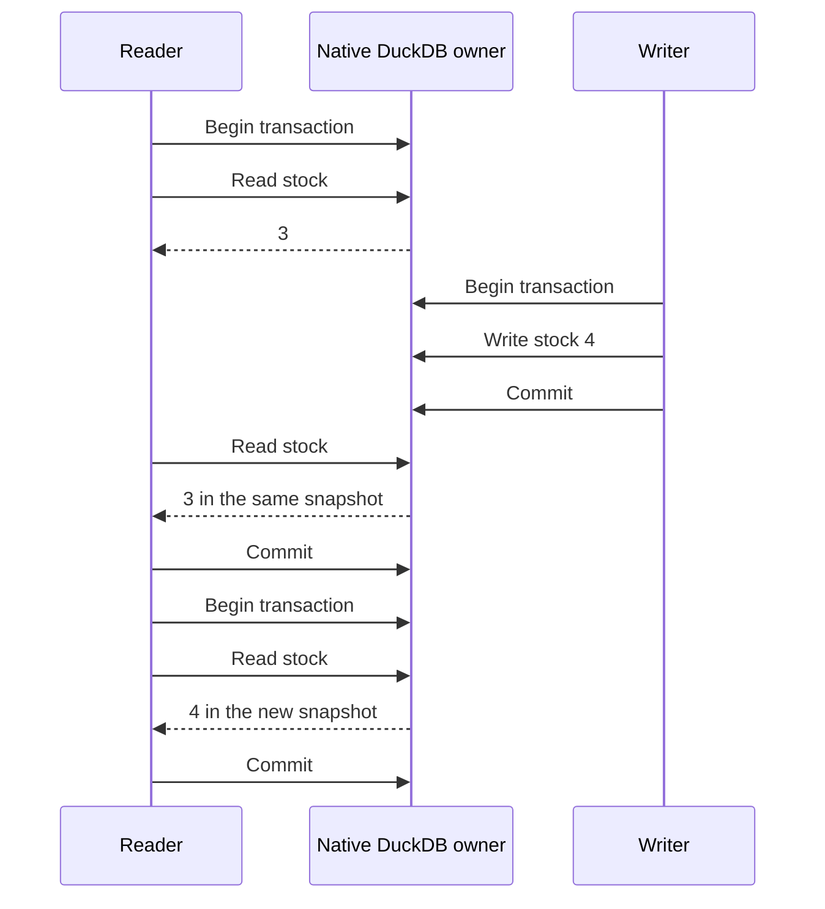

<p align="center">
  
</p>

# DuckOnWire

**One database. Independent clients. Native DuckDB.**

Share a persistent DuckDB database through a small C++ owner server and Quack `CONNECT`. Applications keep real DuckDB connections, prepared statements and transactions. HTTPFS and Quack are built in: no `LOAD` or extension setup.

- **Read while writers work:** independent sessions and snapshot isolation.
- **Keep your native API:** ordinary DuckDB C/C++ objects and paired language drivers.
- **Keep your data:** committed writes persist; closing a session rolls back pending changes.

[Download rc.4](https://github.com/misaelzapata/duckonwire/releases/tag/v0.2.0-rc.4) · [Native CI](https://github.com/misaelzapata/duckonwire/actions/runs/37986385488) · [MIT license](LICENSE)

## Start in minutes

Download the matching native bundle and verify its `SHA256SUMS`. On macOS 26 ARM64:

```sh
tar -xzf duckonwire-0.2.0-rc.4-macos26-arm64.tar.gz
cd duckonwire-0.2.0-rc.4-macos26-arm64
export DUCKONWIRE_TOKEN='choose-your-token'
bin/duckonwire-server --root . --init-demo
```

In another terminal, set the same token and run ordinary CRUD or the transaction demo:

```sh
export DUCKONWIRE_TOKEN='choose-your-token'
bin/cpp-crud-client
bin/transaction-flow
```

CRUD inserts Cafe and Arroz, updates stock, reads both, deletes Arroz and commits. Its final row is `[[1,"Cafe","19.99",4]]`; running it again preserves other clients' rows.

The server defaults to `quack:127.0.0.1:9495` and `data/demo.duckdb`. Clients can override `DUCKONWIRE_ENDPOINT`. Use `--init-demo` only for an empty database; restart without it. The Linux bundle targets Ubuntu 24.04, x86-64-v3, glibc 2.39, libcurl 4 and OpenSSL 3.

## Native connections, clear transactions

A client creates an actual DuckDB connection:

```cpp
duckdb::DuckDB database(nullptr);
duckdb::Connection connection(database);
auto result = connection.Query(
    "CONNECT 'quack:127.0.0.1:9495' (TOKEN 'choose-your-token')");
if (result->HasError()) result->ThrowError();
```

The runnable examples escape connection settings and bind data values. Each connected session has its own transaction. Statements autocommit unless you use `BEGIN`; `COMMIT` confirms writes and `ROLLBACK` discards pending work.



Use a separate connection per concurrent worker. Two writers changing the same row can conflict: roll back and re-read before retrying. If the connection breaks during `COMMIT`, reconcile the outcome before repeating a non-idempotent write. The [native transaction flow](examples/transaction_flow.cpp) checks snapshots, rollback and conflict recovery.

## Measured with readers and writers

Fresh **rc.4 binaries** inserted **2,000,000 rows per mode**, with **4 writers + 4 readers**, and verified counts/checksums after reopening. Every reader completed queries during writes.

| Native Quack over loopback | Insert rows/s | Mean mixed read latency |
| --- | ---: | ---: |
| macOS 26 ARM64 | 1,500,866 | 29.10 ms |
| Ubuntu 24.04 x86-64-v3 | 854,892 | 49.10 ms |

Writes use 80 typed prepared `INSERT SELECT range` batches of 25,000 rows. One native client process has eight worker threads with independent connections; Quack adds the owner process. Reads mix point joins, counts, aggregation and latest-price windows. These are hardware-dependent observations: batch-generated rows, not two million individual network inserts, and loopback rather than WAN latency.

See the immutable [release manifest](https://github.com/misaelzapata/duckonwire/releases/download/v0.2.0-rc.4/release.json), [macOS results](https://github.com/misaelzapata/duckonwire/releases/download/v0.2.0-rc.4/benchmark-macos.json) and [Linux results](https://github.com/misaelzapata/duckonwire/releases/download/v0.2.0-rc.4/benchmark-linux.json). Both platforms passed **21 native checks, 14 transaction-flow checks and 17 bootstrap checks**. Older rc.3 results remain historical evidence.

## Ten language examples

[C](examples/crud_c.c) · [C++](examples/crud_cpp.cpp) · [Python](examples/python/crud.py) · [Node.js](examples/node/crud.mjs) · [Go](examples/go/crud/main.go)
[Rust](examples/rust/src/crud.rs) · [Java](examples/java/NormalCrud.java) · [Swift](examples/swift/Crud.swift) · [C#](examples/csharp/crud/Program.cs) · [Lua](examples/lua/client.lua)

Native bundles and CMake build C/C++. The other eight bindings require separate pairing with this engine; stock packages bundling a different engine are incompatible. These examples are separate from fresh C/C++ release qualification.

## Build from source

Requirements: CMake 3.24+, Ninja, Git, C++17, OpenSSL/libcurl development files and upstream build dependencies.

```sh
git clone https://github.com/misaelzapata/duckonwire.git
cd duckonwire
cmake -S . -B build -G Ninja -DCMAKE_BUILD_TYPE=Release
cmake --build build --parallel 3
ctest --test-dir build --output-on-failure
```

Use `build/bin/` instead of `bin/`. This is **experimental**: DuckDB `v2.1.0-dev0`, Quack protocol 7, paired client/server builds. Windows and other runtime targets are not qualified.

<details>
<summary>Source pins, upstream updates and packaging</summary>

Our server, tests and examples live here. [DuckDB](https://github.com/misaelzapata/duckdb/tree/duckonwire/native) and [Quack](https://github.com/misaelzapata/duckdb-quack/tree/duckonwire/native) changes live in separate forks. [Pins.cmake](cmake/Pins.cmake) fixes DuckDB `848126236a4a8879f232bed7ab5f702683a55300`, Quack `a6e7cb9243ee3d7ec0e5371b720be3292a32061f` and official HTTPFS `96a2f2e88e5dd075facbc5a65dc3afd67aa2bb44`.

CMake keeps clean checkouts in `upstream/` and build copies in `build/sources/`; it does not replay core/Quack patches. Canonical diffs remain in `patches/`. To update upstream, fetch it, choose a fixed commit, merge or rebase on a new integration branch, then rebuild and retest before changing pins. Never follow a moving HEAD.

[Package.cmake](cmake/Package.cmake) packages a clean committed checkout and completed native build, verifies installed binaries, and emits an archive, manifest and checksums. GitHub supplies source archives at the release tag. [Historical results index](tests/results/index.json) preserves prior build provenance.

</details>

## Public demo

**46,462 real manufacturer-brand products** from Argentina and Spain, with reproducible **synthetic prices**. No stores, retailer/private-label brands or private identifiers. Included [CSV](examples/demo/products.csv) and [schema](examples/demo/schema.sql) support `--init-demo`; the benchmark uses a separate generated fixture. Own code is MIT; see [third-party notices](THIRD_PARTY_NOTICES.txt).

## Español

DuckOnWire comparte una base DuckDB con conexiones nativas y un servidor C++ propietario del archivo. Descargar rc.4, configurar `DUCKONWIRE_TOKEN` y ejecutar `bin/duckonwire-server --root . --init-demo`; en otra terminal, usar `bin/cpp-crud-client`. Reiniciar sin `--init-demo`. Cada sesión conserva su snapshot hasta terminar la transacción; `COMMIT` confirma y `ROLLBACK` descarta cambios. Los resultados anteriores miden dos millones de filas con cuatro escritores y cuatro lectores. Es experimental; C/C++ viene incluido y los demás bindings requieren emparejamiento.

## 中文

DuckOnWire 使用原生 C++ 服务器共享 DuckDB 文件，客户端保留真实 DuckDB API。下载 rc.4，设置 `DUCKONWIRE_TOKEN`，运行服务器与 CRUD 示例。独立事务保留读取快照；提交确认写入，回滚撤销修改。上表为 200 万行、四写四读的回环实测。项目为实验性版本，其他语言需配对 bindings。
