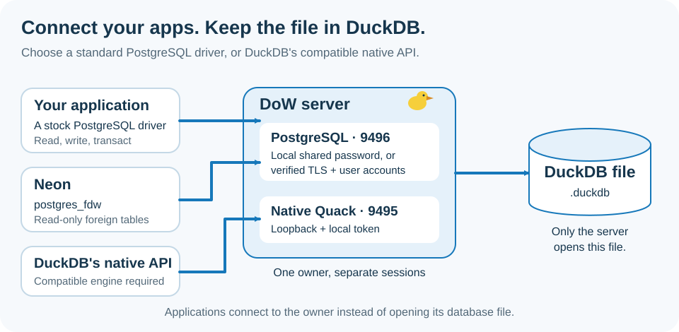
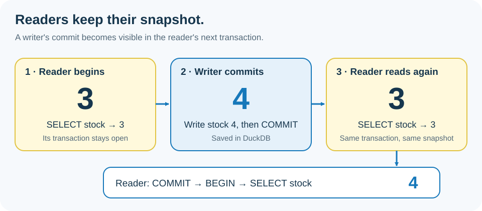

<p align="center">
  
</p>

# DuckOnWire (DoW)

**DuckDB, connected.**

## Install and try it

On compatible Linux x86_64 machines, install the ready-to-run package and start the server:

```sh
curl -fsSL https://raw.githubusercontent.com/misaelzapata/duckonwire/main/scripts/install.sh | sh -s -- --prefix ./duckonwire
export DUCKONWIRE_TOKEN='your-local-password'
./duckonwire/bin/duckonwire-server --root ./duckonwire
```

Leave that terminal running. In another terminal, use the same password with your installed `psql` client:

```sh
export PGPASSWORD='your-local-password'
export PGHOST=127.0.0.1 PGPORT=9496 PGUSER=duckonwire PGDATABASE=duckonwire PGSSLMODE=disable
psql -X -v ON_ERROR_STOP=1 <<'SQL'
BEGIN;
CREATE TABLE IF NOT EXISTS inventory(id INTEGER PRIMARY KEY, name VARCHAR, stock INTEGER);
INSERT INTO inventory VALUES(1, 'Coffee', 3), (2, 'Rice', 10) ON CONFLICT DO NOTHING;
SELECT name, stock FROM inventory ORDER BY id;
UPDATE inventory SET stock = stock + 1 WHERE id = 1;
DELETE FROM inventory WHERE id = 2;
COMMIT;
SELECT name, stock FROM inventory ORDER BY id;
SQL
```

On the first run, the last query returns Coffee with stock 4. This is one ordinary connection reading and writing DuckDB. The local server listens on your machine and shares one password; [remote accounts use verified TLS](#public-access). On Mac or ARM, start with [Docker](#try-with-docker) or [build from source](#build-from-source). Ctrl+C stops the server; its database stays in `duckonwire/data`.

[](https://github.com/misaelzapata/duckonwire/actions/workflows/verify.yml) [](.github/workflows/verify.yml) [](https://github.com/misaelzapata/duckonwire/actions/workflows/docker.yml)

DoW turns your DuckDB database into a shared data service. Connect apps in your favorite language, read and write through the same connection, and let readers keep working while new data arrives. Your data stays in DuckDB.

[Download](https://github.com/misaelzapata/duckonwire/releases) · [Try Docker](#try-with-docker) · [Connect from Neon](#query-from-neon) · [Examples](#examples-and-tests) · [Español](#español) · [中文](#中文) · [MIT](LICENSE)

## Tutorial

Here's a path from your first query to a small application:

1. **Start one server.** Choose [Docker](#try-with-docker) or a [downloaded package](#connect). The server owns the database file; your clients connect to it.
2. **Log in with your usual driver.** Local connections share a password. For a remote server, use a [username, password and verified TLS](#public-access). Your client does not need a new DuckDB installation.
3. **Read and change data on the same connection.** The [Node example](examples/postgres/node/crud.mjs) inserts two products, updates one, deletes the other and reads the committed result. There are [examples for ten languages](#examples-and-tests).
4. **Give each worker its own connection.** A reader can keep its snapshot while a writer commits new data. Try the [transaction example](#transactions) to see when those changes become visible.
5. **Read a page at a time.** Use a stable order and a row limit; [continue from the last ID](#read-in-pages) for deeper pages.
6. **Measure your workload.** Try [concurrent inserts](#try-concurrent-inserts), then compare query timings with the same data, returned rows and hardware.

**One connection can read and write.** Use `SELECT`, `INSERT`, `UPDATE` and `DELETE` on the same connection, with `BEGIN`, `COMMIT` and `ROLLBACK` when you need a transaction. A `write` account allows both reading and writing; a `read` account allows only reading. The [Neon example](#query-from-neon) separately provides read-only foreign tables.

<p align="center">
  
</p>

Use [native Quack](#native-connections-clear-transactions) when you want DuckDB's own API with the compatible engine. For most apps, start with the PostgreSQL route above.

## Try with Docker

Clone this repository, open its folder and run:

```sh
docker compose up --build -d
docker compose exec -T duckonwire psql -X -v ON_ERROR_STOP=1 <<'SQL'
CREATE TABLE IF NOT EXISTS inventory(id INTEGER PRIMARY KEY, name VARCHAR, stock INTEGER);
INSERT INTO inventory VALUES(1, 'Coffee', 3) ON CONFLICT DO NOTHING;
BEGIN;
SELECT name, stock FROM inventory WHERE id = 1;
UPDATE inventory SET stock = stock + 1 WHERE id = 1;
SELECT name, stock FROM inventory WHERE id = 1;
COMMIT;
SQL
```

On the first run, stock changes from 3 to 4. The first build takes several minutes. Docker prepares separate writer and reader accounts, random passwords and verified local TLS. The included `psql` reads its saved login automatically:

```sh
docker compose exec -e PGUSER=reader duckonwire psql -X -c 'SELECT name, stock FROM inventory'
```

When you're finished:

```sh
docker compose stop
```

Stopping preserves the database in its named volume. Port `9496` is published only on `127.0.0.1`. The [Docker workflow](.github/workflows/docker.yml) tests AMD64 and ARM64, transactions, permissions, persistence and concurrent inserts.

## Connect

DoW is experimental. Clients use PostgreSQL drivers, and queries run in DuckDB SQL.

Keep the local server above running. From the repository or installed package folder, use the same `PG*` settings with the [Node example](examples/postgres/node/crud.mjs):

```sh
npm install --prefix examples/postgres/node
node examples/postgres/node/crud.mjs
```

The example inserts Coffee and Rice, updates stock, reads the rows, deletes Rice and commits. It prints `"passed":true` and `[[1,"Coffee","19.99",4]]`. Open the [Node source](examples/postgres/node/crud.mjs) to see the connection and bound parameters, or pick another language below.

Defaults are PostgreSQL `127.0.0.1:9496`, Quack `127.0.0.1:9495` and database `data/demo.duckdb`. In this local mode, everyone uses the shared password; the username is a label, not a separate account.

<details>
<summary>Your own database and remote connections</summary>

Keep the database inside the server's workspace and stop any other process that has it open for writing:

```sh
mkdir -p workspace
./bin/duckonwire-server --root workspace --database data/app.duckdb
```

The C++ server opens or creates `workspace/data/app.duckdb` and gives each client its own connection and transaction. Other applications connect to the server instead of opening the file directly. Stop the previous server first, or use different `--port` and `--pg-port` values for another database.

Without `DUCKONWIRE_TOKEN`, the server generates a token in its private runtime descriptor. Local PostgreSQL uses cleartext password authentication on loopback. For remote access, use the protected setup below or an encrypted SSH tunnel:

```sh
ssh -N -L 19496:127.0.0.1:9496 your-user@your-server
```

Connect to `PGHOST=127.0.0.1 PGPORT=19496` with the server's password. Standard `PGHOST`, `PGPORT`, `PGUSER`, `PGDATABASE` and `PGPASSWORD` settings work with the examples; `DUCKONWIRE_TOKEN` is also accepted as a password.

</details>

## Query from Neon

Connect Neon to DoW once, then query `duckonwire.products` and `duckonwire.prices` from your normal Neon connection. You can join them with Neon tables; the data stays in DuckDB.

The [Neon setup guide](docs/neon.md) walks through the hostname, certificate, reader login, setup and cleanup. This integration uses read-only foreign tables. For reading and writing, connect your app directly to DoW with a `write` account: the same connection handles both.

```sql
SELECT id, name, brand FROM duckonwire.products ORDER BY id LIMIT 5;
```

Use DoW 0.3 or newer for Neon support. [Integration results](tests/results/neon-integration.json) include a real Neon connection, complete product reads and queries while another connection writes.

## Public access

Users log in with their usual PostgreSQL **username and password**. TLS encrypts the connection and verifies the server; SCRAM checks the password without sending it. Give each account database-wide `read` or `write` access. This is separate from local shared-password mode.

<details>
<summary>Set up accounts and verified TLS</summary>

Put the server certificate, private key and rules file inside the server root. The certificate must match the hostname clients use. Keep the key and rules file mode `0600` or `0400`; clients need a trusted issuing CA.

Generate passwords and SCRAM verifiers. The rules file contains verifiers, not the original passwords:

```sh
export PGPASSWORD="$(openssl rand -hex 32)"
verifier="$(printf '%s\n' "$PGPASSWORD" | ./bin/duckonwire-password)"
export PGREADER_USER=reader PGREADER_PASSWORD="$(openssl rand -hex 32)"
reader_verifier="$(printf '%s\n' "$PGREADER_PASSWORD" | ./bin/duckonwire-password)"
(umask 077; printf 'database\tduckonwire\nuser\tapp\twrite\t%s\nuser\treader\tread\t%s\n' "$verifier" "$reader_verifier" > access.tsv)
./bin/duckonwire-server --access-file access.tsv \
  --tls-cert server.crt --tls-key server.key --pg-host 0.0.0.0
```

Stop the local server before starting this one. Import external data before enabling protected mode. The tab-separated file starts with `database`, database name; each following record is `user`, username, `read` or `write`, verifier. Restart to apply changes.

On a client, use that account's password and verify the server certificate:

```sh
export PGHOST=db.example.com PGPORT=9496 PGUSER=app PGDATABASE=duckonwire
export PGSSLMODE=verify-full PGSSLROOTCERT=ca.pem
node examples/postgres/node/crud.mjs
```

Readers can query and use transactions. Writers can also change rows and tables. Unknown accounts and database names are rejected. Keep passwords out of URLs, command arguments and logs; do not disable TLS verification. [Permission tests](tests/results/public-access.json).

| Connection mode | Login | `PGDATABASE` |
| --- | --- | --- |
| Local, one database | Shared server token; username is a label | Any name connects to the one open database |
| Protected | Real account and password, verified TLS | Must match the account's configured database |

PostgreSQL connections report `PostgreSQL 16.0 wire-compatible DuckOnWire` from `version()`, followed by the DuckDB engine version. This helps tools identify the connection; SQL still runs in DuckDB. Native Quack connections keep DuckDB's usual `version()`.

Network `COPY TO STDOUT` and `COPY FROM STDIN` return an explicit unsupported-operation error. Send inserts in bound batches and read rows with `SELECT`. Trusted local connections can still export CSV to a server-side file; protected accounts cannot access files.

</details>

<details>
<summary>Permissions and query limits</summary>

The PostgreSQL endpoint runs up to 8 queries at once and requests cancellation after 30 seconds by default. Extra work returns `53300`; cancellation returns `57014`. After an explicit transaction fails, roll it back before retrying. Cancellation is cooperative, so blocked I/O can take longer.

Protected mode sizes its buffers for the available memory, leaving room for connections and query work, up to 1 GiB. Spill storage is limited to 1 GiB; idle/incomplete connections close after 300 seconds. These are not hard limits on total process memory or I/O. Use `--max-queries` and `--query-timeout-ms` to adjust query limits.

Protected SQL cannot read external files or networks, install extensions or change server configuration. Import data locally first. Permissions cover the database, not individual tables or rows; full PostgreSQL roles and SCRAM channel binding are not implemented.

Quack remains a separate trusted loopback connection with the local token. PostgreSQL accounts, permissions and query limits do not apply to it.

</details>

## Native connections, clear transactions

Use Quack with DuckOnWire's compatible native engine. HTTPFS and Quack are built in; no extension paths or `LOAD` commands are needed. An unrelated stock DuckDB engine is not automatically compatible. Exact bindings and protocol versions are recorded in [AGENTS.md](AGENTS.md) and the [result index](tests/results/index.json).

### ATTACH a remote catalog

On a native connection, read remote tables by name and join them with local data:

```sql
ATTACH 'quack:127.0.0.1:9495' AS remote (TOKEN 'your-server-token');
SELECT id, name, brand FROM remote.main.products LIMIT 5;
```

`remote` is the catalog alias and `main` is the schema. The sample table exists after `--init-demo`.

### CONNECT for parameters, writes and transactions

Switch the connection to the server:

```sql
CONNECT remote;
```

Subsequent SQL and bound values run on the server. Use this for parameterized queries, CRUD and transactions: plain `ATTACH` has limits with parameters, updates/deletes and cached schema metadata. Use `DISCONNECT` to resume local queries, then `DETACH remote` to remove the alias.

The [ATTACH example](examples/attach.cpp) reads and joins remote data, then uses `CONNECT remote` for changes, commit and rollback. It removes its own sample table. After building current source:

```sh
export DUCKONWIRE_ENDPOINT=quack:127.0.0.1:9495
export DUCKONWIRE_TOKEN='your-server-token'
./build/bin/attach-client
```

Installed packages also have `./bin/cpp-crud-client` for direct `CONNECT`. The new ATTACH executable is available in current source builds; check a package's included files before using it.

### Transactions

Use one connection per concurrent worker. Statements commit automatically unless you send `BEGIN`; `COMMIT` keeps changes and `ROLLBACK` discards them. Closing a connection rolls back pending work.

Readers keep their view until the transaction ends. Two writers changing the same row can conflict: roll back and re-read before retrying. If a connection breaks during `COMMIT`, check the outcome before repeating the write.

<p align="center">
  
</p>

<details>
<summary>Run the snapshot example or try a rollback</summary>

With the native server running and its `DUCKONWIRE_TOKEN` set, run the [transaction example](examples/transaction_flow.cpp):

```sh
./bin/transaction-flow
```

It creates its own table with stock 3, checks the snapshot shown above, then tests rollback and write conflicts. It removes that table when finished. Use `./build/bin/transaction-flow` after building source. Quack is a local connection, so this command connects to a server running on your machine, rather than the unpublished Quack port inside Docker.

For the Docker inventory, open `docker compose exec duckonwire psql -X` and try:

```sql
BEGIN;
UPDATE inventory SET stock = 999 WHERE id = 1;
SELECT stock FROM inventory WHERE id = 1;
ROLLBACK;
SELECT stock FROM inventory WHERE id = 1;
```

The first read shows your pending change. The last read shows the stock before the transaction. A requested PostgreSQL `READ COMMITTED` transaction keeps DuckDB's snapshot until it ends; `SERIALIZABLE` is rejected.

</details>

## Examples and tests

CI verifies **115 checks** across seven native test suites, plus **20 PostgreSQL integration checks**, ordinary-driver examples and concurrent reads during million-row inserts. The [release workflow](.github/workflows/release.yml) builds a fresh package and publishes it only after tests, the tutorial and Docker pass. [See the results](tests/results/index.json).

Ordinary PostgreSQL drivers, using standard `PG*` settings:

[Node.js](examples/postgres/node/crud.mjs) · [Python](examples/postgres/python/crud.py) · [Java](examples/postgres/java/Crud.java) · [C](examples/postgres/c/crud.c) · [C++](examples/postgres/cpp/crud.cpp) · [Swift](examples/postgres/swift/Crud.swift) · [Lua](examples/postgres/lua/crud.lua) · [Go](examples/postgres/go/main.go) · [Rust](examples/postgres/rust/src/main.rs) · [C#](examples/postgres/csharp/Program.cs).

<details>
<summary>Run other language examples</summary>

```sh
pip install -r examples/postgres/python/requirements.txt
python examples/postgres/python/crud.py
(cd examples/postgres/go && go run .)
cargo run --manifest-path examples/postgres/rust/Cargo.toml
dotnet run --project examples/postgres/csharp/Crud.csproj
```

Java uses PostgreSQL JDBC on its classpath. C/C++, Swift and Lua use libpq; Lua runs through LuaJIT. Tested driver versions and platform coverage are in the [PostgreSQL results](tests/results/postgres-compatibility.json).

Native Quack examples use compatible bindings: [C](examples/crud_c.c) · [C++](examples/crud_cpp.cpp) · [Python](examples/python/crud.py) · [Node.js](examples/node/crud.mjs) · [Go](examples/go/crud/main.go) · [Rust](examples/rust/src/crud.rs) · [Java](examples/java/NormalCrud.java) · [Swift](examples/swift/Crud.swift) · [C#](examples/csharp/crud/Program.cs) · [Lua](examples/lua/client.lua). Some binding tests are historical; check the [result index](tests/results/index.json) before treating them as current package support.

</details>

### Try concurrent inserts

The [Node ingestion example](examples/postgres/node/ingest.mjs) sends bound values in batches of 1,000. Four writers insert while four readers run joins, grouped sums and latest-price windows. It checks the results and removes its fixture tables:

```sh
PG_INGEST_ROWS=100000 node examples/postgres/node/ingest.mjs
node examples/postgres/node/ingest.mjs
```

The second command sends two million rows. Use a test database and run one copy at a time. For protected access, set `PGREADER_USER` and `PGREADER_PASSWORD`; otherwise readers use the writer's login. The JSON reports throughput, read latency, commits and each reader's progress.

With the public demo loaded, add `PG_DEMO_READS=1` to also run its ten queries while inserts arrive. These reads check the unchanged demo tables; inserts go into separate test tables in the same database. The output reports each query's latency and verifies its results.

With a million-price demo loaded, one local Apple M1 Pro run sent **two million client rows at 280,300 rows/s** while running all ten demo queries. Reads averaged **17.97 ms**. Timing included row creation, transport and 2,000 confirmed commits; login, setup and final checks were excluded. Counts, checksums and query results passed in-session. These are local measurements; several complex queries still exceed 10 ms. [Measured conditions](tests/results/performance.json).

`bulk.mjs` and the native benchmark generate rows inside DuckDB with `INSERT SELECT range`. Those results measure database-side generation and writes, not client-data transport. See their distinct conditions in the [result index](tests/results/index.json).

## Public demo

The sample contains **46,462 manufacturer-brand products** from Argentina and Spain, with **synthetic prices**. It has no stores, private-label brands or private identifiers. [CSV](examples/demo/products.csv) and [schema](examples/demo/schema.sql) are included for `--init-demo`. Add that option when first starting an empty database from the package folder; it refuses to import over existing tables. Omit it on restart. Benchmarks use separate tables. Own code is MIT; see [third-party notices](THIRD_PARTY_NOTICES.txt).

Current source builds can also create **one million price observations over 30 days**. Start with an empty demo database:

```sh
./build/bin/duckonwire-server --init-demo --demo-prices 1000000
```

The data is repeatable and generated inside DuckDB; there is no large CSV to download. Try [price history](examples/postgres/queries/product-history.sql), [seven-day trends](examples/postgres/queries/seven-day-average.sql) or [changes by brand](examples/postgres/queries/brand-movement.sql). The default sample still has one price per product.

### Read in pages

Start with a small result, then ask for the next page. The web playground does this through its page-size control and Previous/Next buttons. In an app, bind the limit and offset with your driver's parameter API, as the [query example](examples/postgres/node/latency.mjs) does.

<details>
<summary>Paging SQL and query timings</summary>

Use a stable order when requesting pages:

```sql
SELECT id, product_id, price, day FROM prices
ORDER BY id LIMIT 100 OFFSET 200;
```

For deeper pages, continue after the last ID instead of skipping earlier rows:

```sql
SELECT id, product_id, price, day FROM prices
WHERE id > 300 ORDER BY id LIMIT 100;
```

Each web request sees a fresh snapshot. For an unchanged view across several pages, use one client connection and keep its transaction open while reading them.

With the same `PG*` connection settings as other examples, measure all ten [demo queries](examples/postgres/queries):

```sh
PG_LATENCY_SAMPLES=30 node examples/postgres/node/latency.mjs
```

The JSON records averages, median, 95th percentile, row checksums and database settings. It measures the full client round trip after warmup, including returned rows. This differs from the web playground's server-side elapsed time: Internet travel and browser work add to what you wait for.

Run it without other builds or writes; the default pause between queries avoids a continuous load. Set `PG_LATENCY_OFFSET` to compare pages, or `PG_LATENCY_PAUSE_MS=0` to measure sustained traffic. DoW uses up to two engine workers, based on the CPU capacity DuckDB detects. Use `--threads` to override this and measure on your hardware.

</details>

## Flask playground

Try the [live playground](https://dow.ofertasya.app/), or run the included [Flask example](examples/postgres/flask). Browse tables, inspect columns, preview rows and run your own SQL. Choose a page size and use Previous/Next to explore results. Ten example queries cover the catalog, price history, market trends and brands. Its source is included under MIT.

Run it with a protected **read-only account**. Connection settings stay on the backend; results are capped at 200 rows and long queries are cancelled. Connections are reused for quicker queries, with a fresh transaction for every request. The reader rule prevents writes.

The displayed time measures work on the web server. Your Internet connection adds travel time; it is not included in that number.

<details>
<summary>Run the web example</summary>

```sh
python3 -m venv .venv-flask
.venv-flask/bin/pip install -r examples/postgres/flask/requirements.txt
export PGHOST=db.example.com PGPORT=9496 PGDATABASE=duckonwire
export PGUSER=reader PGPASSWORD='your-reader-account-password' PGSSLMODE=verify-full
cd examples/postgres/flask
../../../.venv-flask/bin/gunicorn --bind 127.0.0.1:8000 --workers 2 --threads 2 --timeout 40 app:app
```

Open `http://127.0.0.1:8000`. Public certificates use system trust roots; set `PGSSLROOTCERT` for a private CA.

</details>

## S3 and Cloudflare R2

Built-in HTTPFS reads object storage from trusted local connections:

```sql
SELECT size FROM read_blob('s3://noaa-ghcn-pds/ghcnd-countries.txt');
```

For Parquet, use `read_parquet('s3://your-bucket/your-file.parquet')`. Private objects need your credentials in a connection-local secret. [S3 setup](https://duckdb.org/docs/current/core_extensions/httpfs/s3api) · [R2 setup](https://duckdb.org/docs/current/guides/network_cloud_storage/cloudflare_r2_import) · [Real read tests](tests/results/object-storage.json).

Protected accounts cannot read external objects or create cloud secrets; import data locally first. Built-in HTTPFS supports explicit credentials; AWS IAM credential chains additionally need the AWS extension.

## Server options


<details>
<summary>Paths, ports, access rules and query limits</summary>

| Option | Purpose | Default or example |
| --- | --- | --- |
| `--root DIRECTORY` | Keep database, runtime state and configuration in one workspace. Directory must exist. | Current directory; `workspace` |
| `--database PATH` | Open or create the database inside the root. | `data/demo.duckdb` |
| `--state PATH` | Store the private descriptor, including the local token. Must differ from the database path. | `.runtime/native.json` |
| `--init-demo` | Import the public sample into an empty database. Omit on restart. | Off |
| `--demo-prices NUMBER` | Generate this many synthetic price observations; requires `--init-demo`. | CSV sample; 46462–10000000 |
| `--threads NUMBER` | DuckDB worker threads. | Automatic, up to `2`; override with 1–64 |
| `--port NUMBER` | Quack loopback port. | `9495`; 1–65535 |
| `--pg-port NUMBER` | PostgreSQL port; `0` selects a free port recorded in the descriptor. | `9496`; 0–65535 |
| `--pg-host ADDRESS` | PostgreSQL listen address. Non-loopback requires protected access. | `127.0.0.1` |
| `--access-file PATH` | Tab-separated database and account rules; requires TLS. | Off; `access.tsv` |
| `--tls-cert PATH` | Server certificate matching the client's hostname. | Required with access rules; `server.crt` |
| `--tls-key PATH` | Private key inside the root, mode `0600` or `0400`. | Required with access rules; `server.key` |
| `--max-queries NUMBER` | Simultaneous PostgreSQL queries; excess work returns `53300`. | `8`; 1–256 |
| `--query-timeout-ms NUMBER` | Request cooperative cancellation after this many milliseconds. | `30000`; 1–3600000 |
| `--help` | Print options and exit. | `./bin/duckonwire-server --help` |

Relative paths resolve inside `--root`. Ctrl+C or SIGTERM closes sessions and removes the runtime descriptor. Do not delete the descriptor or database while the server is running.

</details>

## For agents and contributors

[AGENTS.md](AGENTS.md) covers ownership, pinned dependencies and checks. The [documentation workflow](.github/workflows/documentation.yml) runs login, transactions, stock drivers and concurrent queries. The [result index](tests/results/index.json) records exact versions and platforms. PostgreSQL protocol support does not imply complete PostgreSQL SQL, catalogs, roles, arrays, network `COPY` or ORM compatibility; queries still run in DuckDB.

## Build from source

<details>
<summary>Build, test and install</summary>

You need CMake, Ninja, a C++ compiler, Git and OpenSSL/libcurl development files:

```sh
git clone https://github.com/misaelzapata/duckonwire.git
cd duckonwire
cmake -S . -B build -G Ninja -DCMAKE_BUILD_TYPE=Release
cmake --build build --parallel 3
ctest --test-dir build --output-on-failure
cmake --install build --prefix dist
```

Run installed examples from `dist`. Exact prerequisites and platform limits are in [AGENTS.md](AGENTS.md); source pins are in [cmake/Pins.cmake](cmake/Pins.cmake). Engine changes live in the [DuckDB](https://github.com/misaelzapata/duckdb/tree/duckonwire/native) and [Quack](https://github.com/misaelzapata/duckdb-quack/tree/duckonwire/native) forks. [Package.cmake](cmake/Package.cmake) contains packaging instructions. This is an experimental project; Windows is not tested.

</details>

## Español

DoW conecta tu base DuckDB con tus aplicaciones. Usa el driver habitual de tu lenguaje y sigue leyendo mientras llegan nuevos datos. **Una misma conexión permite leer y escribir:** puedes hacer `SELECT`, `INSERT`, `UPDATE` y `DELETE`, además de `BEGIN`, `COMMIT` y `ROLLBACK`. Una cuenta `write` permite ambas cosas; una cuenta `read`, solo consultar. La base permanece en DuckDB. [Instala y prueba](#install-and-try-it) el paquete en Linux compatible, o ejecuta `docker compose up --build -d`; Docker prepara las cuentas y TLS, y `docker compose stop` conserva la base.

El [tutorial](#tutorial) sigue un recorrido sencillo: iniciar el servidor, entrar con tu driver, cambiar datos, probar un lector y un escritor, pedir páginas y medir. El gráfico de transacciones muestra cuándo un lector ve los cambios confirmados; hasta terminar su transacción conserva la vista anterior.

Desde [Neon](#query-from-neon), `postgres_fdw` presenta las tablas remotas para consultarlas y unirlas con datos locales. El ejemplo usa una cuenta de solo lectura y TLS verificado; los datos permanecen en DuckDB.

En local se comparte una contraseña. Por red puedes configurar usuarios reales con permisos de lectura o escritura. Quack requiere el motor nativo compatible: `ATTACH` permite leer y unir tablas, y `CONNECT remote` es la ruta para consultas parametrizadas, CRUD y transacciones.

`COMMIT` confirma cambios, `ROLLBACK` los descarta y cerrar revierte lo pendiente. Cada trabajador usa su conexión. Hay [diez ejemplos](#examples-and-tests), una [página Flask](#flask-playground) y una [guía para agentes](AGENTS.md); los detalles de configuración y compilación están en apartados desplegables.

Para comparar tiempos, usa la misma consulta, cantidad de filas y equipo. El tiempo de la página mide trabajo en el servidor; tu conexión a Internet añade demora. El ejemplo de Node mide el viaje completo de la consulta.

## 中文

DuckOnWire（DoW）让应用连接 DuckDB，在新数据写入时继续读取。普通 PostgreSQL 驱动无需更换客户端 DuckDB；Docker 自动配置本地账号与 TLS，Neon 可通过只读 `postgres_fdw` 和验证 TLS 查询远程表。

原生 Quack 需要匹配的引擎：`ATTACH` 用于读取和连接远程表，参数查询、写入及事务使用 `CONNECT remote`。项目提供十种语言示例，MIT 许可。

教程展示启动、登录、同一连接读写、事务快照、分页与测量。读者在事务结束后才看到新提交的数据；网页的服务器耗时不等于完整网络等待时间。
